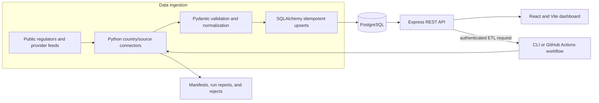
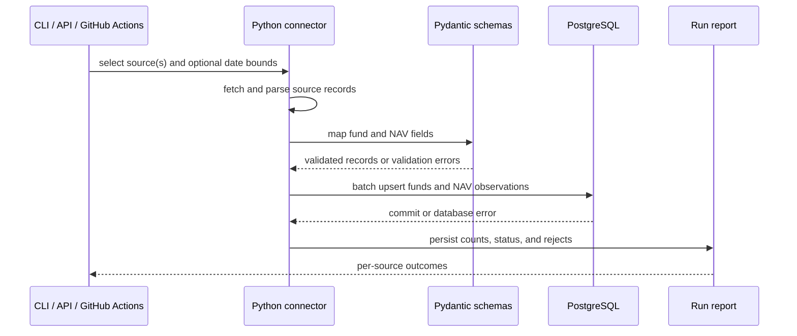
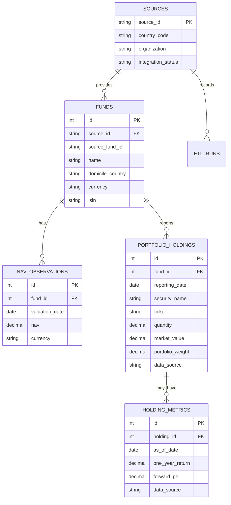
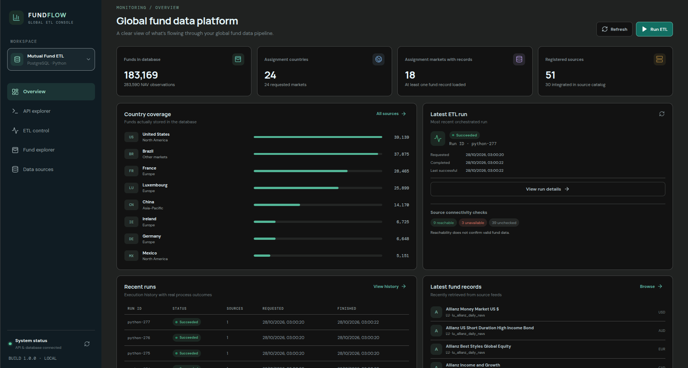
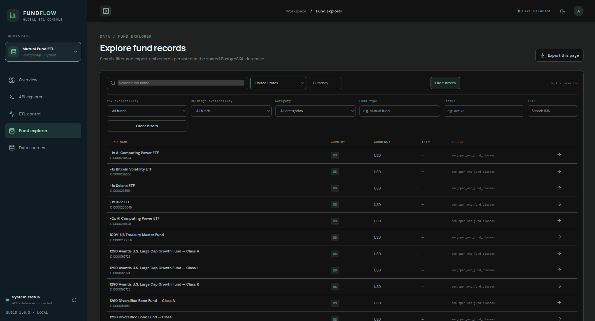
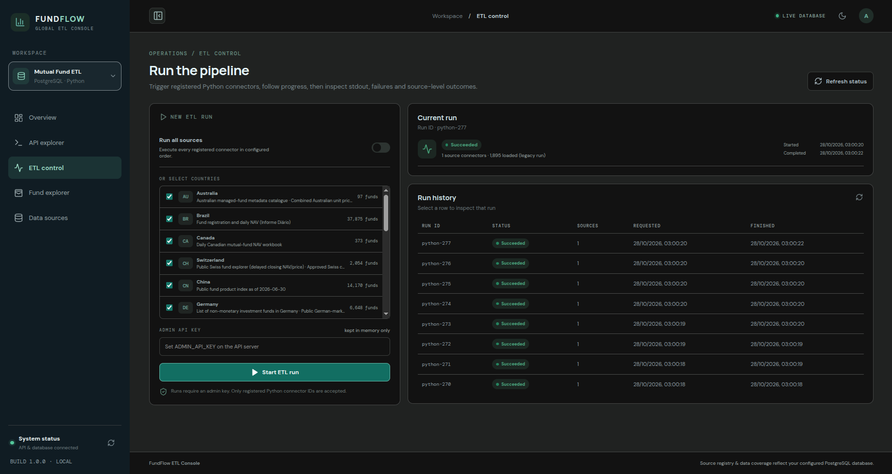
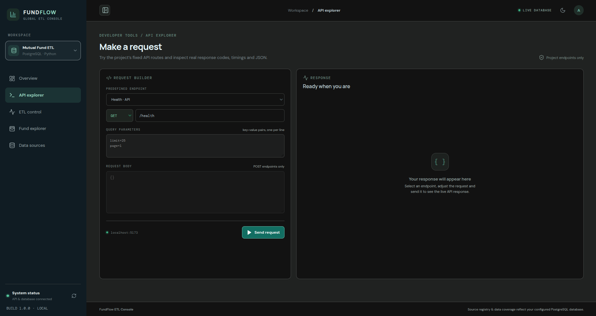

# FundFlow — Global Mutual Fund Data Platform

FundFlow collects mutual-fund reference data, NAV observations, and selected portfolio holdings from public and provider sources. Python connectors validate and normalize source records into PostgreSQL; an Express API and React dashboard expose the records that are actually available.

<p align="center">
  <a href="https://github.com/Ansari-Maaz/Mutual-Funds-ETL-Pipeline/actions/workflows/etl.yml"></a>
  
  
  
  
</p>

> **Project status:** The ETL, database schema, API, and dashboard are implemented. Source coverage and data freshness differ by provider. The deployment is not currently verified as live; the statistics below are explicitly dated local snapshots, not a live service claim.

## Contents

- [Overview](#overview)
- [Features](#features)
- [Architecture](#architecture)
- [ETL workflow](#etl-workflow)
- [Data model](#data-model)
- [Country and market coverage](#country-and-market-coverage)
- [Snapshot statistics](#snapshot-statistics)
- [Technology stack](#technology-stack)
- [Quick start](#quick-start)
- [API](#api)
- [Automation and deployment](#automation-and-deployment)
- [Testing](#testing)
- [Screenshots](#screenshots)
- [Repository map](#repository-map)
- [Limitations and roadmap](#limitations-and-roadmap)
- [Documentation and sources](#documentation-and-sources)
- [Contributing, security, and license](#contributing-security-and-license)

## Overview

FundFlow addresses the fragmented formats and uneven availability of mutual-fund data across national registers and provider feeds. Source-specific connectors turn selected records into a shared model while preserving source identifiers and provenance. The API and dashboard make the stored records searchable and inspectable.

The project is useful for exploring cross-market fund metadata, available NAV histories, source coverage, selected filed holdings, and ETL run outcomes. A source appearing in the catalogue does not mean it has an operational connector or usable data; the coverage table and linked inventories distinguish records observed in the saved snapshot from registry-only entries.

## Features

| Area | Implemented capability | Coverage note |
| --- | --- | --- |
| Fund discovery | Search, country/currency/category/type/status/ISIN filters, NAV and holdings status filters, pagination, CSV export | Only source-provided fields are populated; nullable fields remain absent |
| NAV | Store dated NAV values with currency and retrieve history per fund | NAV history exists for a subset of funds and sources |
| Portfolio holdings | Store report-date positions and source provenance; expose historical dates and optional separately sourced metrics | SEC N-PORT and Brazil CVM CDA importers exist; availability differs by market and fund |
| Data engineering | Python source connectors, Pydantic validation, SQLAlchemy upserts, Alembic migrations, run reports and rejects | Provider-specific parsing and limits apply |
| API | Fund, NAV, holdings, country, source, health, statistics, and ETL run endpoints | ETL controls require an administrator API key |
| Dashboard | Overview, fund explorer and profiles, source registry, API explorer, ETL controls, run history | Displays the records returned by the configured database |

## Architecture



The Python CLI is the ingestion authority. The API reads the same PostgreSQL database and can start the CLI for authenticated ETL requests. The dashboard makes API requests at runtime. The weekly GitHub Actions workflow is configured, but a workflow definition alone does not prove a recent run succeeded.

## ETL workflow

1. **Extract:** Each registered connector obtains its source data through the source’s supported HTTP/download or local input path.
2. **Validate and transform:** Connector parsing maps records into canonical fund and NAV schemas. Pydantic rejects invalid required fields and formats. Some connectors also write source-specific reject records.
3. **Deduplicate and load:** PostgreSQL unique constraints and `INSERT … ON CONFLICT` upserts make repeated fund and NAV ingestion idempotent. Fund keys are `(source_id, source_fund_id)`; NAV keys are `(fund_id, valuation_date, currency)`.
4. **Track:** Python run rows, per-source results, manifests, latest-run reports, and rejects record outcomes. A failed connector returns a failure result and does not make the whole `run --all` operation claim that every source succeeded.
5. **Refresh:** Run the CLI manually, request an authenticated API run, or dispatch the configured GitHub Actions workflow. The workflow schedule is weekly (Sunday at 02:00 UTC); actual execution depends on GitHub Actions availability and configured secrets.



There is no universal retry guarantee across connectors. Network behavior, pagination, backfill window, and failure handling are connector-specific. Review the run result before treating a refresh as complete.

## Data model

`funds` stores source-linked fund identity and available metadata; `nav_observations` stores dated time-series values; `portfolio_holdings` stores positions by fund and reporting date. `holding_metrics` keeps optional vendor or calculated metrics separate from filed positions and records their source, as-of date, and calculation basis.



Fund reference records and NAV history are different data: a fund row represents an identified product/class; each NAV row represents a valuation at a specific date and currency. Holdings are point-in-time positions, not NAV observations. Missing values are preserved as null rather than inferred.

## Country and market coverage

The following table lists only markets with at least one fund record in the **saved local coverage snapshot dated 2026-10-28**. “Loaded sources / registered” and record counts reflect that snapshot; they may change after ingestion. Spain is included as an additional market outside the 24-market target set. Registry-only markets are omitted.

| Region | Country / market | Loaded sources / registered | Funds | NAV rows | Holdings in snapshot | Snapshot status |
| --- | --- | ---: | ---: | ---: | ---: | --- |
| North America | Canada (`CA`) | 1 / 2 | 373 | 373 | 0 | Records loaded |
| North America | Mexico (`MX`) | 1 / 2 | 5,151 | 3,486 | 0 | Records loaded |
| North America | United States (`US`) | 2 / 3 | 39,139 | 24,847 | 17,487 funds / 5,433,511 rows | Records loaded |
| Europe | Denmark (`DK`) | 1 / 2 | 1,486 | 0 | 0 | Records loaded |
| Europe | France (`FR`) | 2 / 2 | 28,465 | 90 | 0 | Records loaded |
| Europe | Germany (`DE`) | 2 / 3 | 6,648 | 248 | 0 | Records loaded |
| Europe | Ireland (`IE`) | 1 / 2 | 6,725 | 0 | 0 | Records loaded |
| Europe | Italy (`IT`) | 2 / 3 | 1,394 | 68 | 0 | Records loaded |
| Europe | Luxembourg (`LU`) | 3 / 4 | 25,899 | 1,944 | 0 | Records loaded |
| Europe | Netherlands (`NL`) | 2 / 3 | 1,390 | 84 | 0 | Records loaded |
| Europe | Spain (`ES`, additional) | 1 / 1 | 3,116 | 0 | 0 | Records loaded |
| Europe | Sweden (`SE`) | 1 / 2 | 726 | 0 | 0 | Records loaded |
| Europe | Switzerland (`CH`) | 2 / 3 | 2,054 | 94 | 0 | Records loaded |
| Europe | United Kingdom (`GB`) | 3 / 4 | 4,261 | 286 | 0 | Records loaded |
| Asia-Pacific | Australia (`AU`) | 2 / 3 | 97 | 5 | 0 | Records loaded |
| Asia-Pacific | China (`CN`) | 1 / 1 | 14,170 | 0 | 0 | Records loaded |
| Asia-Pacific | Hong Kong (`HK`) | 1 / 2 | 2,255 | 0 | 0 | Records loaded |
| Other markets | Brazil (`BR`) | 1 / 1 | 37,875 | 252,065 | 0 | Records loaded |
| Other markets | South Africa (`ZA`) | 1 / 2 | 1,945 | 0 | 0 | Records loaded |

The source registry includes identified candidates as well as integrated sources. For example, some country-level registers supply fund metadata only; the absence of NAV values is intentional when the source does not publish NAV in the ingested dataset. Hong Kong records describe products authorized for public offering and should not be interpreted as Hong Kong-domiciled funds. See the [country coverage CSV](reports/FundFlow_Country_Coverage_New.csv) and [source inventory](reports/FundFlow_Data_Source_Inventory_New.csv) for details and provenance.

## Snapshot statistics

| Metric | Saved local snapshot (2026-10-28) |
| --- | ---: |
| Funds | 183,169 |
| NAV observations | 283,590 |
| Target markets with fund records | 18 of 24 |
| Registered source rows | 51 |
| Sources marked integrated in the API snapshot | 30 |
| US funds with holdings | 17,487 |
| US holdings rows | 5,433,511 |

These are historical local snapshot values recorded in the [report evidence notes](reports/FundFlow_Report_Evidence_New.md), not live production guarantees. The current database could not be queried while this README was prepared. At runtime, `GET /api/v1/stats` reads fund, NAV, country, and source counts directly from the configured database; the CSV inventory includes the country-level holdings snapshot and its report-date span. Counts can change after ETL runs.

## NAV and portfolio holdings

### NAV history

NAV (net asset value) is the per-share or per-unit valuation a source reports for a fund at a valuation date. FundFlow stores validated observations with a date, value, currency, and retrieval timestamp. The fund list and profile APIs expose fund metadata and latest NAV separately from the historical NAV endpoint. Coverage depends on the source: Brazil contributes substantial daily history in the saved snapshot, while several connected registers publish fund records without NAV.

### Portfolio holdings

A holding is a reported position in a fund’s portfolio at a reporting date. The schema stores the fund link, security name, ticker/ISIN/CUSIP when supplied, quantity, market value and currency, portfolio weight, source URL, and reporting date. A unique constraint makes repeated imports for the same fund/report date/position idempotent while retaining other reporting dates.

- **United States:** `sync-sec-holdings` maps eligible US fund classes to SEC series/registrant data and imports public Form N-PORT filings. It requires a descriptive `USER_AGENT` that includes a monitored contact email. The importer uses a rolling filing lookback and does not perform an unlimited historical backfill. The SEC’s filing coverage and dissemination timing limit availability; not every fund type is represented.
- **Brazil:** `sync-cvm-holdings --month YYYYMM` imports public CVM CDA monthly portfolio composition. Positions may be consolidated or omitted under confidentiality rules. Portfolio weight is calculated only when reported position market value and fund net assets are available; the source and calculation basis are recorded separately.
- **Optional metrics:** First-bought date, share change, one-year return, forward P/E, and sector live in `holding_metrics`, separate from filed holdings. Values remain null unless an attributed source or supported calculation supplies them. The saved coverage snapshot contains holdings only for US funds; CVM support exists in code but did not produce holdings rows in that snapshot.

## Technology stack

| Layer | Technology | Role |
| --- | --- | --- |
| ETL | Python 3.10+, HTTPX, PyYAML, OpenPyXL | Connector execution, downloads, parsing, and reports |
| Validation | Pydantic 2 | Canonical fund and NAV validation |
| ORM and migrations | SQLAlchemy 2, Alembic | PostgreSQL persistence and schema evolution |
| Database | PostgreSQL 16 | Fund, NAV, holdings, source, and run records |
| API | Node.js, Express, `pg`, Zod | REST endpoints, request validation, ETL orchestration |
| API security | Helmet, CORS, `express-rate-limit` | HTTP hardening, origin policy, rate limits |
| Dashboard | React 18, Vite, Lucide React | Browser UI and API explorer |
| Automation | GitHub Actions | Weekly/manual ETL workflow, configured in `.github/workflows/etl.yml` |
| Tests | Pytest, Vitest, Supertest | Python tests and mocked API tests |

Versions and dependency ranges are maintained in [`pyproject.toml`](pyproject.toml), [`requirements.txt`](requirements.txt), and the respective `package.json` files.

## Quick start

### Prerequisites

- Python 3.10 or newer
- Node.js and npm
- Docker with Compose, or an existing PostgreSQL 16 database
- Network access to install dependencies and reach the selected public sources

### 1. Clone and configure Python

```bash
git clone https://github.com/Ansari-Maaz/Mutual-Funds-ETL-Pipeline.git
cd Mutual-Funds-ETL-Pipeline
python3 -m venv .venv
source .venv/bin/activate
python -m pip install --upgrade pip
pip install -r requirements.txt
cp .env.example .env
```

Edit `.env` and set `DATABASE_URL` for your PostgreSQL database. `HTTP_TIMEOUT_SECONDS` controls source request timeouts. Set `USER_AGENT` to a descriptive application identity; SEC requests must include a monitored contact email. Never commit `.env` or credentials.

### 2. Start PostgreSQL and initialize the schema

For a local development database:

```bash
docker compose up -d db
alembic upgrade head
python -m app.cli sync-sources
```

The Compose service uses PostgreSQL 16, port `5433`, and a persistent Docker volume for local development. On production, set `DATABASE_URL` to the intended production database before applying migrations; the migration command is forward-only and does not seed fund records.

### 3. Run ingestion

```bash
python -m app.cli inventory
python -m app.cli verify-sources
python -m app.cli run --all
```

Run a single registered connector with `python -m app.cli run --source cvm_open_fund_data`. Holdings are separate sync commands:

```bash
python -m app.cli sync-sec-holdings
python -m app.cli sync-cvm-holdings --month YYYYMM
```

The SEC command requires `USER_AGENT` with a contact email. The CVM command requires a real month in `YYYYMM` format. Connector ingestion writes latest-run reports and may write source-specific rejects under `reports/`.

### 4. Start the API

In a separate terminal, from the repository root:

```bash
cd api
cp .env.example .env
npm install
```

Set a unique `ADMIN_API_KEY` in `api/.env`, then start the server:

```bash
npm start
```

The API listens on `http://localhost:3001` by default and reads `DATABASE_URL` from the project root `.env`. Do not use a real production administrator key in local examples or commit it.

### 5. Start the dashboard

In another terminal:

```bash
cd frontend
cp .env.example .env
npm install
npm run dev
```

Open [http://localhost:5173](http://localhost:5173). `VITE_API_BASE_URL` may be set to the API origin; when empty, the frontend uses the current origin, which is suitable when frontend and API share a host or a development proxy is configured.

## API

Base URL for local development: `http://localhost:3001`. Endpoints return JSON; errors use an `error` object with a code and message. Health checks report service/database connectivity, not whether useful fund data has been ingested.

| Method | Path | Purpose and notable parameters |
| --- | --- | --- |
| `GET` | `/health` | API process/version health |
| `GET` | `/api/v1/health/database` | Database connection status |
| `GET` | `/api/v1/health/etl` | Latest ETL status |
| `GET` | `/api/v1/stats` | Live DB counts and most recent run |
| `GET` | `/api/v1/countries` | Country source/fund/NAV summary |
| `GET` | `/api/v1/sources` | Registry records, ingestion counts, latest source check |
| `GET` | `/api/v1/sources/:id` | One source record |
| `POST` | `/api/v1/sources/:id/check` | Check an allowed registered source endpoint |
| `GET` | `/api/v1/funds` | Search/list; `page`, `limit` (max 100), `country`, `currency`, `q`, `category`, `fund_type`, `status`, `holdings_status`, `isin`, `has_nav`, `sort`, `order` |
| `GET` | `/api/v1/funds/:id` | Fund profile and latest NAV |
| `GET` | `/api/v1/funds/:id/nav` | NAV history; optional `from`, `to`, `limit` (max 5,000) |
| `GET` | `/api/v1/funds/:id/holdings` | Latest or historical holdings; optional `report_date`, `limit` (max 5,000); response includes status and report dates |
| `GET` | `/api/v1/etl/runs` | Run history; `limit` 1–100 |
| `GET` | `/api/v1/etl/runs/:id` | Run detail by API UUID or `python-N` ID |
| `POST` | `/api/v1/etl/runs` | Start a protected run; requires `X-API-Key` and either `all`, `sourceIds`, or `countryCodes` |

Examples:

```bash
curl http://localhost:3001/api/v1/stats
curl 'http://localhost:3001/api/v1/funds?country=US&has_nav=true&page=1&limit=25'
curl 'http://localhost:3001/api/v1/funds/123/holdings?report_date=2026-06-30'
```

The holdings response has the shape `{ "data": [...], "status": "available", "reportDate": "YYYY-MM-DD", "reportDates": [...], "count": 0 }`; each field depends on source availability. The API does not fabricate absent values. See [API inventory](reports/FundFlow_API_Inventory_New.md) for the full inspected route list.

## Automation and deployment

`.github/workflows/etl.yml` supports manual dispatch and a weekly schedule (Sunday 02:00 UTC). It applies Alembic migrations, syncs the source registry, runs configured ETL connectors, syncs SEC holdings, then prints database counts. It requires GitHub secrets named `DATABASE_URL` and `USER_AGENT`; the SEC user agent must include a monitored contact email. The workflow is configured in the repository, but this README does not claim that the most recent run succeeded.

The repository includes a Docker Compose PostgreSQL service and a Python Dockerfile. No currently verified hosted frontend/API/database deployment is documented here. For safe production setup, point `DATABASE_URL` at the intended persistent PostgreSQL database, apply forward migrations, initialize sources, then run ingestion. Keep admin keys and database URLs in the hosting provider’s secret settings.

## Testing

Available checks:

```bash
./.venv/bin/python -m pytest
(cd api && npm test)
(cd frontend && npm run build)
```

The API integration check is separate and requires a running database, API configuration, and the evidence expected by `api/tests/integration-live.js`:

```bash
(cd api && npm run test:integration)
```

The Python suite covers catalog and transformation behavior; API tests use a mocked database adapter. The live integration check should not be described as passing unless it is run against a prepared local environment. Test counts and outcomes are intentionally not shown as current badges here.

## Screenshots and demo

These screenshots show the FundFlow dashboard in dark mode. The [full 1:43 walkthrough video](docs/media/fundflow-demo.webm) is included in WebM format (23 MB).

### Overview



### Fund Explorer



### ETL Control



### API Explorer



## Repository map

```text
app/                         Python ETL CLI, connectors, models, schemas, holdings importers
api/src/                     Express API, PostgreSQL queries, ETL orchestration
api/tests/                   API unit and live integration tests
frontend/src/                React dashboard and API client
config/                      Candidate source configuration
migrations/                  Alembic schema migrations
scripts/                     Production initialization and refresh helpers
tests/                       Python unit tests
docs/                        Architecture, schema, testing, source, and limitation notes
reports/                     Source evidence, manifests, samples, and generated reports
.github/workflows/etl.yml     Scheduled/manual ETL workflow
```

## Limitations and roadmap

- Public source availability, field names, frequency, licensing, and historical depth differ by provider. Fund counts are not a measure of complete national market coverage.
- Some registered markets have no ingested records in the saved snapshot; some operational feeds provide metadata but no NAV.
- Holdings availability is partial. SEC N-PORT is not a universal fund holdings feed; CVM CDA may consolidate or omit positions. Optional valuation metrics require separate attributed data.
- Source websites and schemas can change. Re-run source verification and inspect run reports before relying on new ingestions.
- Commercial reuse rights have not been reviewed for every provider. Review source terms before redistributing data or using it commercially.
- No license file is present, so repository reuse terms have not been established.

Practical next steps:

- [ ] Capture and commit genuine dashboard screenshots.
- [ ] Re-verify source coverage and refresh the snapshot statistics from a reachable database.
- [ ] Expand NAV and holdings coverage only where a permitted, structured source is available.
- [ ] Add connector-focused tests for parsing, date/currency handling, and failure cases.
- [ ] Add current deployment/runbook documentation after a hosting arrangement is verified.

## Documentation and sources

- [Complete technical report (Markdown)](reports/FundFlow_Complete_Technical_Report_New.md)
- [Complete technical report (PDF)](reports/FundFlow_Complete_Technical_Report_New.pdf)
- [Country coverage snapshot](reports/FundFlow_Country_Coverage_New.csv)
- [Data source inventory](reports/FundFlow_Data_Source_Inventory_New.csv)
- [Database inventory](reports/FundFlow_Database_Inventory_New.md)
- [API inventory](reports/FundFlow_API_Inventory_New.md)
- [Evidence and verification notes](reports/FundFlow_Report_Evidence_New.md)
- [Architecture notes](docs/ARCHITECTURE.md)
- [Database schema notes](docs/DATABASE_SCHEMA.md)
- [Adding a source](docs/ADDING_A_SOURCE.md)
- [Testing notes](docs/TESTING.md)
- [Limitations](docs/LIMITATIONS.md)

Selected official sources implemented in the connectors:

- [U.S. SEC investment-company data](https://www.sec.gov/data-research/sec-markets-data/investment-company-series-class-information) and [SEC EDGAR filings](https://www.sec.gov/edgar/search/)
- [Brazil CVM daily fund data](https://dados.cvm.gov.br/dataset/fi-doc-inf_diario) and [CVM CDA portfolio composition](https://dados.cvm.gov.br/dataset/fi-doc-cda)
- [China CSRC](https://www.csrc.gov.cn/)
- [UK Financial Conduct Authority](https://www.fca.org.uk/firms/financial-services-register)
- [Australia GSFM unit prices](https://www.gsfm.com.au/funds-data/combined-unit-prices/)

For the broader list, access methods, and recorded limitations, see the linked source inventory. GitHub’s README guidance recommends explaining what a project does, how to get started, and using relative paths for repository resources; this document follows that structure ([GitHub README documentation](https://docs.github.com/en/repositories/managing-your-repositorys-settings-and-features/customizing-your-repository/about-readmes)).

## Contributing, security, and license

Issues and pull requests are welcome. For connector changes, include source provenance, parsing/validation tests, and an example of how failures and missing fields are handled. Run the relevant Python/API checks before submitting a change. There is no separate contribution guide at present.

Do not commit `.env` files, database dumps, API keys, credentials, or private source data. Use environment variables or the hosting platform’s secret manager. No dedicated security reporting policy is currently defined; report concerns privately to the repository owner where possible.

No `LICENSE` file is present. No license is claimed by this README.
