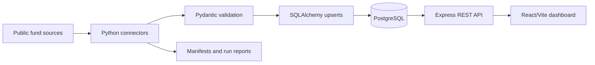

# Global Mutual Fund ETL Platform

An evidence-driven prototype for collecting mutual fund data from public international sources, normalizing it into a common model, storing it in PostgreSQL, and exposing the result through a REST API and interactive dashboard.

The project was built for the MFAPIs global mutual-fund data assignment. It prioritizes transparent source attribution, repeatable ingestion, idempotent database writes, and honest reporting of unavailable or restricted data.

## Highlights

- 17 modular source connectors across public regulator, government, association, and provider datasets.
- 162,584 normalized fund records and 252,030 NAV observations in the recorded database snapshot.
- Canonical Pydantic validation for fund and NAV records.
- PostgreSQL persistence with SQLAlchemy and Alembic migrations.
- Idempotent fund and NAV upserts that prevent duplicate records on repeat runs.
- Source manifests with URLs, download timestamps, file sizes, and SHA-256 hashes.
- Express REST API with protected ETL controls and source connectivity checks.
- React/Vite dashboard for source monitoring, fund search, NAV history, API exploration, and ETL run history.
- Fund profile view with source-backed provider, category, fund type, status, inception date, latest NAV, and official source link when available.
- Automated Python and API tests plus a production frontend build.

## Architecture



### Main components

| Component | Location | Responsibility |
| --- | --- | --- |
| Python ETL | `app/` | Extraction, parsing, validation, transformation, orchestration, and loading |
| Connectors | `app/connectors/` | Source-specific HTTP, CSV, XLSX, XML, PDF, and JSON integrations |
| Data model | `app/models/`, `app/schemas/` | SQLAlchemy tables and canonical Pydantic contracts |
| Database migrations | `migrations/` | PostgreSQL schema creation and API operations tables |
| REST API | `api/src/` | Fund, NAV, source, statistics, health, and ETL endpoints |
| Dashboard | `frontend/src/` | Operational UI for exploring and testing the platform |
| Evidence | `reports/` | Source verification, manifests, samples, rejects, and run results |

## Technology Stack

- **Python 3.10+**
- **HTTPX** for HTTP extraction
- **Pydantic 2** for canonical validation
- **SQLAlchemy 2** for relational persistence
- **Alembic** for migrations
- **PostgreSQL 16** for storage
- **Node.js and Express** for the REST API
- **Zod** for API request validation
- **Helmet, CORS, and express-rate-limit** for API hardening
- **React 18, Vite, and Lucide React** for the dashboard
- **Pytest and Vitest** for automated testing

## Assignment Coverage

### Requested markets

| Status | Markets |
| --- | --- |
| Imported source data | United States, United Kingdom, Germany, France, Italy, Switzerland, Netherlands, Denmark, Sweden, China, Australia, Hong Kong, Brazil |
| Researched but not yet imported | Canada, Mexico, Japan, South Korea, Singapore, Taiwan, Russia |
| Additional markets imported | Ireland, Luxembourg, South Africa |
| Additional market researched and integrated | Spain |
| Expansion source candidate only | United Arab Emirates |

The catalogue covers all 20 requested countries and the four expansion markets. A catalogue entry is not presented as a successful integration unless the project has evidence of usable extracted data.

### Current data boundary

- Brazil provides 252,029 NAV observations.
- Australia provides one explicitly currency-labelled NAV observation.
- Many other sources provide fund-master snapshots without NAV or currency fields.
- Broad holdings ingestion is not implemented yet.
- Commercial reuse terms must be reviewed with each provider before redistribution.

See [reports/latest_run.md](reports/latest_run.md), [reports/dataset_research.md](reports/dataset_research.md), and [docs/LIMITATIONS.md](docs/LIMITATIONS.md) for evidence and limitations.

## Requirements

### Local prerequisites

- Python 3.10 or newer
- Node.js and npm
- PostgreSQL 16, or Docker with Compose support
- Git, curl, and package-index access

### Environment files

The repository contains safe templates:

- `.env.example` for the Python ETL database and HTTP settings
- `api/.env.example` for the API server
- `frontend/.env.example` for optional frontend API configuration

Never commit `.env`, `api/.env`, or `frontend/.env`.

## Quick Start

Run these commands from the project root.

### 1. Create the Python environment

```bash
python3 -m venv .venv
source .venv/bin/activate
python -m pip install --upgrade pip
pip install -r requirements.txt
cp .env.example .env
```

### 2. Start PostgreSQL

For a fresh machine with Docker Compose:

```bash
docker compose up -d db
```

For the existing project container:

```bash
docker start mf-etl-pipeline-db
```

The database is exposed at `localhost:5433` with the default local credentials from `.env.example`.

### 3. Apply migrations and register sources

```bash
source .venv/bin/activate
alembic upgrade head
python -m app.cli sync-sources
```

### 4. Run the Python ETL

```bash
python -m app.cli inventory
python -m app.cli verify-sources
python -m app.cli run --all
```

Run one connector:

```bash
python -m app.cli run --source cvm_open_fund_data
```

Bound date-aware extraction where supported:

```bash
python -m app.cli run \
  --source cvm_open_fund_data \
  --start-date 2026-01-01 \
  --end-date 2026-01-31
```

The CLI writes run summaries to `reports/latest_run.json` and `reports/latest_run.md`. Rejected source rows are written as JSONL files under `reports/`.

## Run the REST API

In a new terminal:

```bash
cd api
cp .env.example .env
npm install
```

Edit `api/.env` and set a private administrator key:

```env
ADMIN_API_KEY=generate_a_long_random_secret
```

Start the API:

```bash
npm start
```

The API listens on `http://localhost:3001`.

### API examples

```bash
curl http://localhost:3001/health
curl http://localhost:3001/api/v1/health/database
curl http://localhost:3001/api/v1/stats
curl http://localhost:3001/api/v1/countries
curl http://localhost:3001/api/v1/sources
curl 'http://localhost:3001/api/v1/funds?country=BR&limit=25&page=1'
curl http://localhost:3001/api/v1/funds/123
curl 'http://localhost:3001/api/v1/funds/123/nav?limit=100'
```

The individual fund response includes nullable profile attributes and the latest stored NAV. Missing values remain `null` and are displayed in the dashboard as unavailable from the source; the UI does not substitute financial values.

Trigger a protected ETL run:

```bash
curl -X POST http://localhost:3001/api/v1/etl/runs \
  -H 'Content-Type: application/json' \
  -H 'X-API-Key: YOUR_ADMIN_API_KEY' \
  -d '{"all":true}'
```

Poll the returned run ID:

```bash
curl http://localhost:3001/api/v1/etl/runs/RUN_ID
```

## Run the Dashboard

In a third terminal:

```bash
cd frontend
cp .env.example .env
npm install
npm run dev
```

Open `http://localhost:5173/`.

The dashboard includes:

- Overview metrics and country coverage
- Fund explorer with search, filters, pagination, and CSV export
- Fund detail and stored NAV history
- Source registry and official-host connectivity checks
- API request explorer
- Protected ETL controls and run history

## API Routes

| Method | Route | Purpose |
| --- | --- | --- |
| `GET` | `/health` | API health and version |
| `GET` | `/api/v1/health/database` | PostgreSQL connectivity |
| `GET` | `/api/v1/health/etl` | ETL process status |
| `GET` | `/api/v1/stats` | Dashboard statistics |
| `GET` | `/api/v1/countries` | Country coverage |
| `GET` | `/api/v1/sources` | Registered sources and counts |
| `GET` | `/api/v1/sources/:id` | Source details |
| `POST` | `/api/v1/sources/:id/check` | Official-host connectivity check |
| `GET` | `/api/v1/funds` | Filtered and paginated funds |
| `GET` | `/api/v1/funds/:id` | Fund details |
| `GET` | `/api/v1/funds/:id/nav` | NAV history |
| `GET` | `/api/v1/etl/runs` | ETL run history |
| `GET` | `/api/v1/etl/runs/:id` | ETL run details and results |
| `POST` | `/api/v1/etl/runs` | Start an authenticated ETL run |

Fund filtering supports `country`, `currency`, `source`, `q`, `page`, `limit`, `sort`, and `order`. The API limit is capped at 100 records per page.

## Database Schema

| Table | Purpose |
| --- | --- |
| `sources` | Source identity, country, verification, integration, and licensing state |
| `funds` | Normalized fund identity and source-native identifiers |
| `nav_observations` | Date-specific NAV values with currency and retrieval metadata |
| `etl_runs` | Python connector execution history and counts |
| `api_etl_runs` | API-triggered process output and per-source results |
| `api_source_checks` | Source connectivity-check history |

Idempotency constraints prevent duplicate funds per source-native identifier and duplicate NAV observations per fund, date, and currency.

See [docs/DATABASE_SCHEMA.md](docs/DATABASE_SCHEMA.md) for the schema diagram and example queries.

## Testing

Run the complete automated checks:

```bash
source .venv/bin/activate
python -m pytest

(cd api && npm test)
(cd frontend && npm run build)
```

The current verified result is:

- 7 Python tests passed
- 15 API tests passed
- Frontend production build passed
- Python source compilation passed

The optional live integration test requires PostgreSQL, the API, and a previously successful ETL report:

```bash
cd api
npm run test:integration
```

It validates PostgreSQL rows and matching API responses without refetching providers.

## Reports and Evidence

- [Source catalogue](reports/source_catalogue.json)
- [Source inventory workbook](reports/global_mutual_fund_source_inventory.xlsx)
- [Dataset research](reports/dataset_research.md)
- [Source verification](reports/source_verification.md)
- [Latest run report](reports/latest_run.md)
- [Latest run JSON](reports/latest_run.json)
- [Sample funds](reports/sample_funds.json)
- [Sample NAV observations](reports/sample_nav.json)
- Source-specific manifests and rejected-row files in `reports/`

Every downloaded snapshot records its source URL, retrieval time, size, and SHA-256 hash where applicable.

## Adding a Source

1. Add the country and source metadata to `app/catalog.py` or the catalogue configuration.
2. Implement a `BaseConnector` subclass under `app/connectors/`.
3. Register the connector in `app/connectors/registry.py`.
4. Map source fields to the canonical fund and NAV contracts.
5. Add focused tests for parsing, validation, rejects, and date handling.
6. Run source verification and the connector locally.
7. Review the generated manifest, report, and licensing notes.

Detailed guidance is available in [docs/ADDING_A_SOURCE.md](docs/ADDING_A_SOURCE.md).

## Limitations and Responsible Use

- Public accessibility does not guarantee permission for commercial redistribution.
- Several sources provide only fund-master data, not NAV history.
- The current model intentionally excludes manager, expense ratio, category, inception date, and descriptive fund history.
- Holdings ingestion and broad historical NAV backfills are future work.
- Some sources publish market-available products rather than funds domiciled in that country; the reports identify this distinction.
- Provider formats and URLs can change, so manifests and verification reports should be refreshed before production use.

## Project Structure

```text
app/                 Python ETL, connectors, models, schemas, and CLI
api/                 Express REST API and API tests
frontend/             React/Vite dashboard
config/               Source configuration
migrations/           Alembic migrations
reports/              Evidence, manifests, samples, and run reports
docs/                 Architecture, schema, testing, and source guides
tests/                Python tests
```

## License and Data Use

This repository is a prototype for evaluation and development. Review the terms of every upstream provider before using, storing, or redistributing its data commercially.
# Global Mutual Fund ETL

A Python/PostgreSQL ETL project for collecting mutual fund reference data and NAV observations with source attribution. It includes canonical validation, SQLAlchemy models and upserts, Alembic migrations, source discovery and verification, Excel reporting, and seventeen live source connectors.

## Setup

Python 3.10+, Docker Compose, and package-index access are required. Copy `.env.example` to `.env`, then run:

```sh
pip install -r requirements.txt
docker compose up -d db
alembic upgrade head
python -m app.cli sync-sources
```

In the current workspace PostgreSQL is already running in container `mf-etl-pipeline-db` on port 5433 with a persistent volume. If it has stopped, run `docker start mf-etl-pipeline-db`; do not start another database on port 5433. On a fresh machine use `docker compose up -d db`.

## Run the pipeline

```sh
python -m app.cli inventory
python -m app.cli verify-sources
python -m app.cli run --all
```

The seventeen implemented providers include the existing Brazil CVM, China CSRC, Australia GSFM, South Africa ASISA, Switzerland FINMA, UK FCA, U.S. SEC, Spain CNMV, Swedish FI, Central Bank of Ireland and France AMF GECO sources, plus official fund lists for Germany, Denmark, Italy, the Netherlands and Luxembourg, and the Hong Kong SFC public-offer product list. To run an individual source, pass its ID:

```sh
python -m app.cli run --source cvm_open_fund_data
python -m app.cli run --source csrc_public_fund_index
python -m app.cli run --source gsfm_unit_prices
python -m app.cli run --source asisa_cis_fund_list
python -m app.cli run --source finma_swiss_fund_list
python -m app.cli run --source fca_authorised_funds
python -m app.cli run --source sec_open_end_fund_classes
python -m app.cli run --source cnmv_spanish_fund_register
python -m app.cli run --source fi_sweden_ucits_holdings
python -m app.cli run --source cbi_authorised_ucits
python -m app.cli run --source amf_geco
python -m app.cli run --source dk_bde_nonmonetary_funds
python -m app.cli run --source de_bde_nonmonetary_funds
python -m app.cli run --source it_bde_nonmonetary_funds
python -m app.cli run --source nl_bde_nonmonetary_funds
python -m app.cli run --source lu_bde_nonmonetary_funds
python -m app.cli run --source hk_sfc_authorised_unit_trusts
```

To download or refresh source snapshots explicitly:

```sh
python -m app.cli download --source cvm_open_fund_data --refresh
python -m app.cli download --source csrc_public_fund_index --refresh
python -m app.cli download --source gsfm_unit_prices --refresh
python -m app.cli download --source asisa_cis_fund_list --refresh
python -m app.cli download --source finma_swiss_fund_list --refresh
python -m app.cli download --source fca_authorised_funds --refresh
python -m app.cli download --source sec_open_end_fund_classes --refresh
python -m app.cli download --source cnmv_spanish_fund_register --refresh
python -m app.cli download --source fi_sweden_ucits_holdings --refresh
python -m app.cli download --source cbi_authorised_ucits --refresh
python -m app.cli download --source amf_geco --refresh
python -m app.cli download --source dk_bde_nonmonetary_funds --refresh
python -m app.cli download --source de_bde_nonmonetary_funds --refresh
python -m app.cli download --source it_bde_nonmonetary_funds --refresh
python -m app.cli download --source nl_bde_nonmonetary_funds --refresh
python -m app.cli download --source lu_bde_nonmonetary_funds --refresh
python -m app.cli download --source hk_sfc_authorised_unit_trusts --refresh
```

Raw source files are stored under `data/raw/` and ignored by Git. Source-specific manifests under `reports/` record URLs, SHA-256 hashes, sizes, and download timestamps. The CVM connector maps official class/subclass identifiers, validates positive NAVs, and loads daily observations. The CSRC, ASISA, and FINMA sources are fund-register/index snapshots without NAV or currency fields, so those values remain null. GSFM's combined export has mixed currencies; the connector loads only rows explicitly labelled `(AUD)` and logs the rest as rejects. The AFM export was excluded because it combines passported funds and managers; the Netherlands fund master instead comes from the Banco de España country-level list.

Successful runs refresh `reports/sample_funds.json`, `reports/sample_nav.json`, and `reports/latest_run.md` from PostgreSQL. Source rejects are saved as JSONL files under `reports/`. Use `--start-date YYYY-MM-DD --end-date YYYY-MM-DD` to bound NAV extraction where the provider supports it.

## Current state

The database currently contains 162,584 funds and 252,030 NAV observations across 17 source datasets. Imported core-market source records cover the United States, United Kingdom, Germany, France, Italy, Switzerland, Netherlands, Denmark, Sweden, China, Australia, Hong Kong public-offer products, and Brazil. Canada, Mexico, Japan, South Korea, Singapore, Taiwan and Russia are still missing. Expansion-market datasets cover Ireland, Luxembourg and South Africa; the UAE remains outstanding. Spain is an additional market. Brazil supplies 252,029 observations; Australia contributes one currency-explicit observation. The new German, Italian, Dutch, Danish and Luxembourg sources are open-ended fund-master snapshots without NAV. The Hong Kong SFC list is for public-offer authorization and does not assert Hong Kong domicile. These source counts are not a claim of complete national market coverage. Commercial reuse terms have not been reviewed. See `reports/latest_run.md`, `reports/dataset_research.md`, and `docs/LIMITATIONS.md` for evidence and remaining gaps.

The holdings schema and broad historical backfill are not implemented. Output reports are under `reports/`.

## Node API and interactive dashboard

An Express API and React/Vite dashboard now sit alongside the Python ETL. They reuse the configured PostgreSQL database and the existing `python -m app.cli run` entry point. API-owned run details and source-check history are stored in `api_etl_runs` and `api_source_checks`, created by Alembic migration `0002_api_operations`.

### Start locally

Use three terminals from the project root:

```sh
docker start mf-etl-pipeline-db  # only if the existing database container is stopped
./.venv/bin/alembic upgrade head
```

Terminal 1, start the API (the API reads the existing root `.env` for `DATABASE_URL`):

```sh
cd api
cp .env.example .env
# Set a unique ADMIN_API_KEY in api/.env before enabling ETL control.
npm install
npm start
```

Terminal 2, start the dashboard:

```sh
cd frontend
cp .env.example .env
npm install
npm run dev
```

Open `http://localhost:5173`. The API listens on `http://localhost:3001`. Configure `ADMIN_API_KEY` in `api/.env`; the value is used only for protected ETL run requests and is never sent to third-party fund providers. `ETL_TIMEOUT_MS`, `PYTHON_EXECUTABLE`, `FRONTEND_ORIGIN`, and `PORT` can also be set there. Source-check requests are limited to official HTTPS hosts registered in the project catalogue; they test connectivity only.

### API examples

```sh
curl http://localhost:3001/health
curl http://localhost:3001/api/v1/health/database
curl http://localhost:3001/api/v1/countries
curl 'http://localhost:3001/api/v1/funds?country=BR&limit=25&page=1'
curl http://localhost:3001/api/v1/sources
curl -X POST http://localhost:3001/api/v1/sources/cvm_open_fund_data/check
curl -X POST http://localhost:3001/api/v1/etl/runs \
  -H 'Content-Type: application/json' -H 'X-API-Key: YOUR_ADMIN_API_KEY' \
  -d '{"all":true}'
curl http://localhost:3001/api/v1/etl/runs
```

ETL runs return `202 Accepted` with an ID. Poll `GET /api/v1/etl/runs/:id` for persisted process output and per-source outcomes. Existing Python CLI runs also appear in the same history using `python-<id>` identifiers; these legacy runs have no captured process stdout. Concurrent ETL runs are rejected. A multi-source request accepts `sourceIds`, or `all:true`; the 17 registered Python connectors are runnable. The Python CLI remains the extraction and loading authority.

### API and dashboard tests

```sh
(cd api && npm test)
(cd api && npm run test:integration)
(cd frontend && npm run build)
./.venv/bin/python -m pytest
```

API tests use a mocked database adapter. The separate live integration check reuses the last completed successful Python run, verifies its downloaded official-source manifest and PostgreSQL rows, then checks the Node API returns the same fund/NAV record; it does not refetch or mutate a source. The dashboard build is static and reads API data at runtime. No test claims a live source extraction unless its ETL run report shows a successful connector outcome.

### Route reference

`GET /health`; `GET /api/v1/health/database`; `GET /api/v1/health/etl`; `GET /api/v1/countries`; `GET /api/v1/sources`; `GET /api/v1/sources/:id`; `POST /api/v1/sources/:id/check`; `GET /api/v1/funds`; `GET /api/v1/funds/:id`; `GET /api/v1/funds/:id/nav`; `GET /api/v1/stats`; `GET /api/v1/etl/runs`; `GET /api/v1/etl/runs/:id`; `POST /api/v1/etl/runs` (admin key required).

Fund filtering supports `country`, `currency`, `source`, and `q`, with `page`, `limit` (maximum 100), `sort`, and `order`. The existing fund schema does not store manager, expense ratio, fund category, inception date, or descriptive history; those fields are intentionally absent. NAV history is available only for the funds that have persisted NAV observations. Records and source registry values are returned as stored; registered candidate countries are not claimed as integrated markets.
