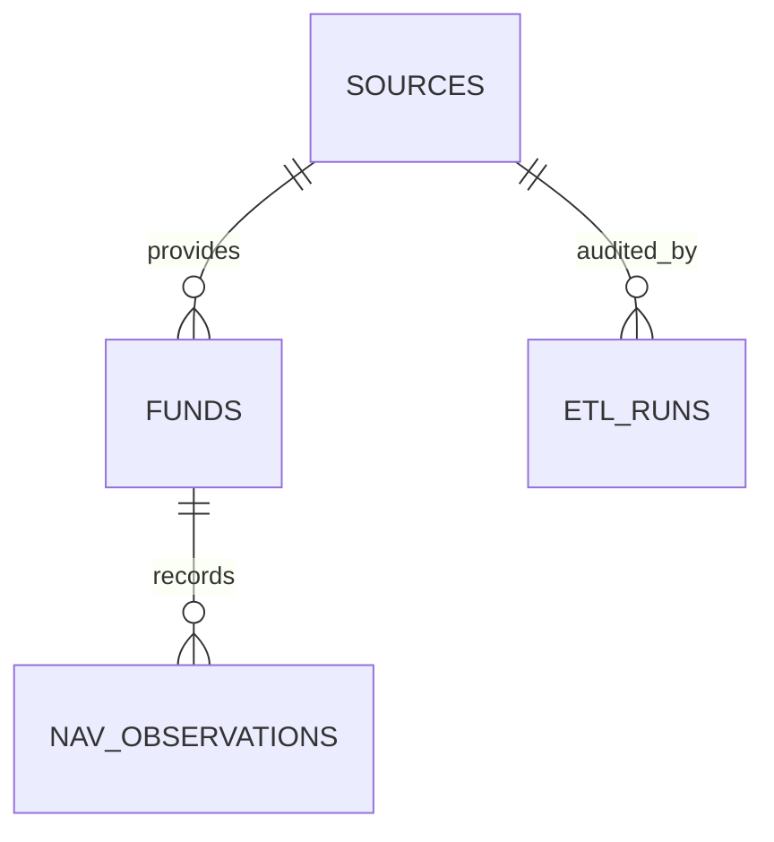

# Architecture

The project has three runtime surfaces:

- Python CLI → provider connector → canonical Pydantic validation → SQLAlchemy PostgreSQL upserts.
- Express REST API → parameterized PostgreSQL queries and protected ETL process orchestration.
- React/Vite dashboard → REST API for monitoring, source checks, fund search, NAV history, and ETL control.

Source configuration separates verification, licensing, and integration state. Records retain source IDs. NAV observations are idempotent by fund/date/currency, and API-launched runs are serialized with a PostgreSQL advisory lock.

The Python orchestration, API orchestration, and dashboard are implemented. Provider coverage remains intentionally incomplete: the current snapshot has 17 runnable connectors, while several requested countries remain documented discovery candidates. See `reports/latest_run.md` and `docs/LIMITATIONS.md` for the evidence-backed coverage boundary.
