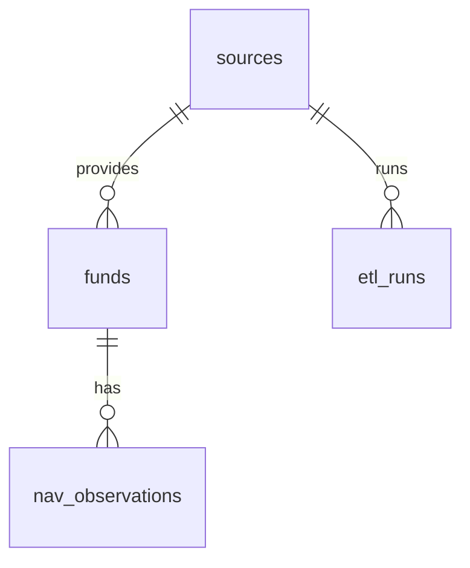

# Database schema

- `sources`: source identity plus verification, integration, and licensing statuses.
- `funds`: source-native ID, name, domicile, currency, ISIN; unique per source/native ID.
- `nav_observations`: Decimal NAV by fund/date/currency with an idempotency constraint.
- `etl_runs`: Python CLI run timestamps, state, source, counts, and error text.
- `api_etl_runs`: API-triggered run requests, process output, JSON results, and status.
- `api_source_checks`: API connectivity-check history for registered sources.

Apply with `alembic upgrade head`. Example queries:

The saved local evidence snapshot dated 2026-10-28 records 51 source rows, 183,169 funds, and 283,590 NAV observations. Counts are dated data evidence, not a claim of complete national market coverage or current production state. Apply migrations with `alembic upgrade head`; refresh from the intended database with the documented ETL commands.

```sql
SELECT country_code, count(*) FROM sources GROUP BY country_code ORDER BY country_code;
SELECT f.name, n.valuation_date, n.nav, n.currency FROM funds f JOIN nav_observations n ON n.fund_id=f.id WHERE f.id=:fund_id ORDER BY n.valuation_date;
SELECT status, count(*) FROM etl_runs GROUP BY status;
```

A run whose process is killed (reboot, CI timeout, container restart) keeps its
`In Progress` row forever. Every new tracked run closes rows older than
`ETL_STALE_RUN_HOURS` (default 12) as `Failed` while it holds the ETL lock; the
same cleanup is available directly:

```bash
python -m app.cli close-stale-runs            # default 12 hours
python -m app.cli close-stale-runs --hours 1
```


