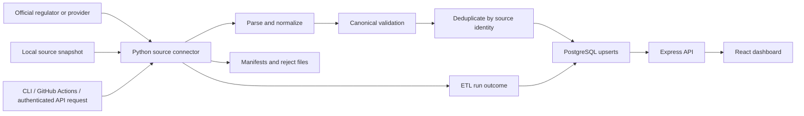
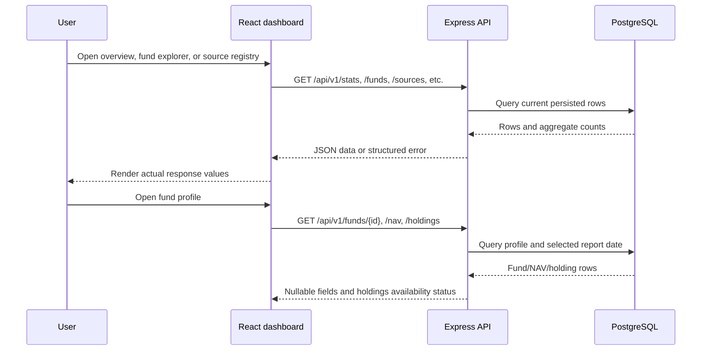

# FundFlow data flow

This document follows a source record through ingestion, persistence, API queries, and the dashboard. FundFlow does not infer missing fund, NAV, holding, or metric values.

## At a glance

## Ingestion path

1. A run is requested from the Python CLI, the configured GitHub Actions workflow, or the API's administrator-protected ETL endpoint. The API validates selected connector IDs and reserves an active run before writing the run row.
2. Each connector checks its input availability, retrieves or reads its source, and parses source-specific rows. File-based extracts live under ignored `data/raw/`; `python -m app.cli fetch-snapshot --source <id> --url <direct-csv-url>` saves supported CSVs and writes a provenance manifest with the final URL, UTC retrieval time, byte count, and SHA-256.
3. Connector output is mapped into the canonical fund and NAV schemas. Required fields are validated; invalid rows are rejected or reported according to the connector. Optional source fields remain null when absent.
4. The loader deduplicates each fund batch by `(source_id, source_fund_id)` and each NAV batch by `(fund_id, valuation_date, currency)`. The last occurrence in a batch wins. PostgreSQL unique constraints and `INSERT ... ON CONFLICT` make repeated ingestion idempotent.
5. A successful or failed source outcome is persisted in the ETL run history. When a connector fails, its failed run row is committed separately so a rollback of source data does not erase the failure record. `run --all` records missing optional local inputs as skipped and exits non-zero if an attempted connector fails.

## What gets stored

| Data | Storage | Identity/history behavior |
| --- | --- | --- |
| Source registry | `sources` | Stable source ID; country, publisher, endpoint, integration and verification state |
| Fund master | `funds` | Unique source ID plus native fund ID; upserted on repeat loads |
| NAV | `nav_observations` | Fund, valuation date, and currency; one observation per key |
| Holdings positions | `portfolio_holdings` | Fund and reporting date, security identity, quantity/value, source and filing provenance |
| Optional holding metrics | `holding_metrics` | Metrics separate from official positions; source, source URL, as-of date, and calculation basis retained |
| Run history | `etl_runs` and `api_etl_runs` | Per-source CLI outcomes and API-orchestrated run state, respectively |

SEC N-PORT and Brazil CVM CDA holdings ingestion are separate from the standard NAV connector run. Position records and external/calculated metrics are stored separately. A fund with no public filing is represented as unavailable or not checked; no placeholder holdings are generated.

## Serving and display path

The dashboard statistics are queried from the configured PostgreSQL database; they are not hardcoded local totals. A successful `/health` response only confirms the API process. `/api/v1/health/database` confirms a database connection, while `/api/v1/stats` reports current database counts. An API error should be treated as an error state rather than interpreted as zero records.

## Operational prerequisites

- Set `DATABASE_URL` to the intended PostgreSQL database for the API and Python CLI.
- Apply forward migrations with `python -m alembic upgrade head` before running ingestion.
- Initialize registry rows with `python -m app.cli sync-sources`.
- Configure `USER_AGENT` for official endpoints that require an application identity, including SEC requests.
- Review per-source run outcomes, skipped inputs, rejects, and source manifests after ingestion; connector availability is not proof of complete market coverage.

See [API reference](API.md), [raw snapshot retrieval](RAW_SNAPSHOTS.md), [database schema](DATABASE_SCHEMA.md), and [limitations](LIMITATIONS.md).
