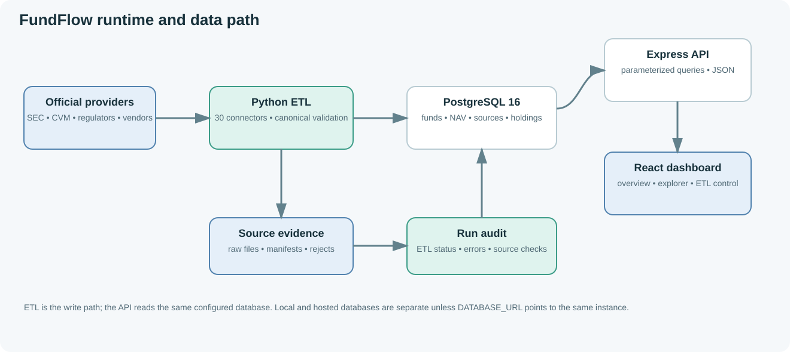
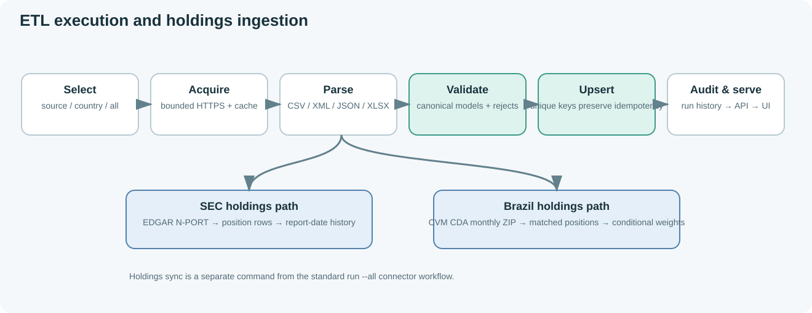
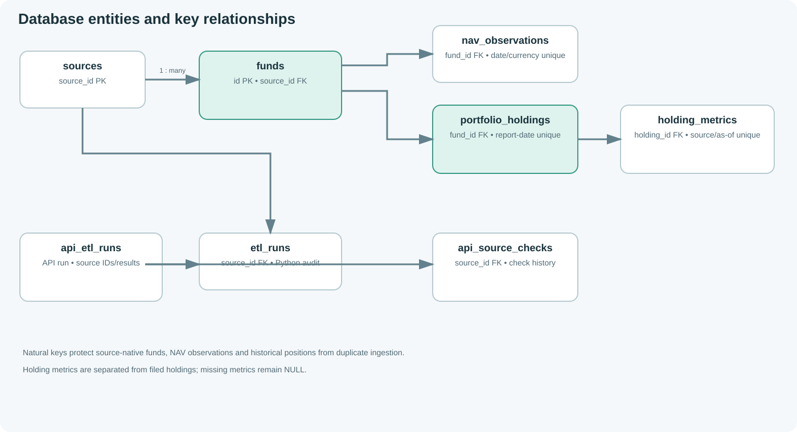
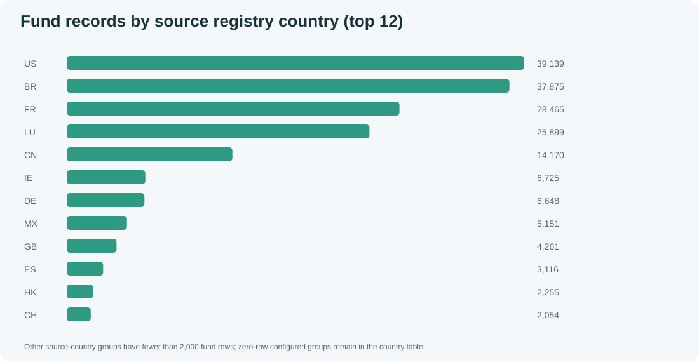
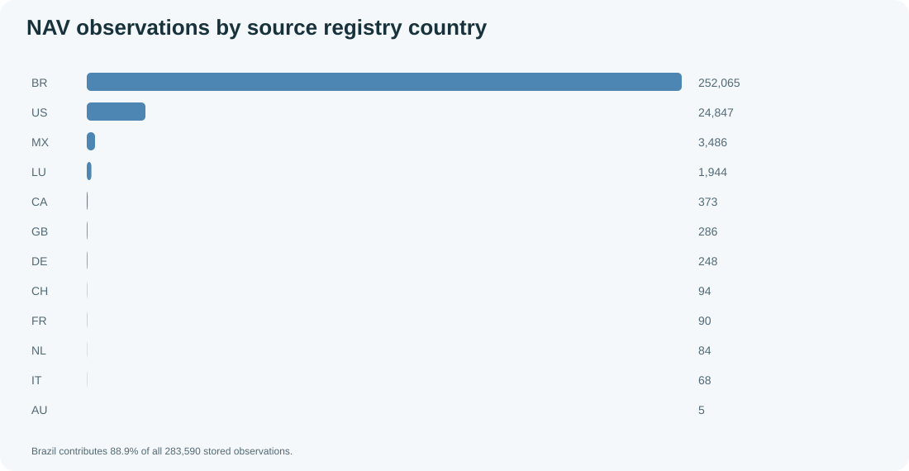

# FundFlow — Complete Technical Report

**Prepared:** 28 October 2026  
**Evidence snapshot:** local PostgreSQL, queried 28 October 2026 at 16:26 UTC; repository source at the current workspace revision  
**Status:** implementation and local data documented; production deployment is not verified



> **Evidence convention.** **Verified** means observed in repository code/configuration, a read-only query of the running local PostgreSQL database, or an official source page linked below. **Historical** means an earlier screenshot or report that is not a current production check. **Unverified** means this workspace does not establish the claim. Counts describe the local database snapshot unless explicitly labelled otherwise.

## Table of contents

1. [Executive summary](#executive-summary)
2. [Project scope and implementation status](#project-scope-and-implementation-status)
3. [System architecture](#system-architecture)
4. [ETL design and execution](#etl-design-and-execution)
5. [Database model and migrations](#database-model-and-migrations)
6. [API and dashboard](#api-and-dashboard)
7. [Local database snapshot and country coverage](#local-database-snapshot-and-country-coverage)
8. [Portfolio holdings and metric coverage](#portfolio-holdings-and-metric-coverage)
9. [Sources, provenance, and licensing](#sources-provenance-and-licensing)
10. [Operations, deployment, and safety](#operations-deployment-and-safety)
11. [Technical requirements](#technical-requirements)
12. [Limitations and next engineering steps](#limitations-and-next-engineering-steps)
13. [Evidence notes and references](#evidence-notes-and-references)

## Executive summary

FundFlow is a Python/PostgreSQL mutual-fund data pipeline with a Node/Express REST API and a React/Vite dashboard. It imports fund reference data and, for a smaller group of markets and products, NAV observations from 30 registered runnable connectors. Source identifiers, retrieved data, migration history, ETL results, and source-check results are persisted in PostgreSQL.

The verified local snapshot contains **183,169 fund rows**, **283,590 NAV observations**, **51 registered sources**, and **24 configured assignment countries**. The database occupies **2,630 MB (about 2.57 GiB)**. Of the 51 source registry rows, 30 are marked Integrated. Integration status is a registry flag, not a promise that every connector succeeds on every run or that every fund has NAV data.

Portfolio holdings are implemented and present in the local database. The snapshot contains **5,433,511 SEC Form N-PORT position rows for 17,487 U.S. funds**, spanning 19 report dates from 30 June 2025 through 31 August 2026. The holdings table stores filed security names, quantities, market values, and weights. Several metrics shown in the design reference are not populated: the 355 separate metric rows contain share-change percentages only; first-bought date, one-year return, forward P/E, and sector are null. No Brazilian holdings have been loaded into this snapshot, although a CVM CDA importer is implemented.

Country records are reported by the country assigned to the source registry, matching the dashboard `/api/v1/countries` query. This does **not** mean every fund is domiciled there. **2,557** fund rows have no domicile country. Brazil supplies **252,065 NAV observations (88.9%)**; U.S. funds account for 24,847 NAV observations and 24,826 distinct funds with NAV.

The database reports migration revision `0006_portfolio_holding_details`. It has 232 Python ETL run records (222 Succeeded, 10 Failed) and five successful API-run records. A prior source report generated on 28 October records a successful SEC fund-master execution, but its run-level counts should not be confused with current aggregate database totals.

**Production is not verified by this report.** The user later reported deleting the Render services. Older user-supplied Render screenshots showed different production totals; those are historical and cannot establish the state of a replacement deployment. A successful API/database health check proves connectivity, not that the service points at the intended database or that migrations and ingestion have run.

## Project scope and implementation status

| Area | Status supported by evidence | Evidence and boundary |
| --- | --- | --- |
| Python ETL and 30 connector classes | Implemented | `app/connectors/registry.py`; local source registry; source-specific parsers and manifests |
| PostgreSQL persistence and migrations | Implemented | SQLAlchemy models, six Alembic revisions, current database at `0006_portfolio_holding_details` |
| Fund and NAV REST API | Implemented | Express routes under `api/src/routes/`; parameterized PostgreSQL queries |
| Overview, fund explorer, source registry, ETL control | Implemented | React dashboard in `frontend/src/App.jsx`; live calls depend on the API and its configured database |
| U.S. SEC N-PORT holdings sync | Implemented and locally populated | 5,433,511 stored positions for 17,487 funds; status and report-date fields on funds |
| Brazilian CVM CDA holdings sync | Implemented, no holdings rows in this snapshot | `app/holdings/cvm_cda.py`; local holdings rows are all `sec_edgar_nport` |
| Historical holdings preservation and duplicate control | Implemented | Unique key per fund, report date, holding index; upsert by that key |
| Metrics separate from filed holdings | Implemented | `holding_metrics` table; current populated metric is derived share change only |
| Production service/database state | Unverified | No live production deployment was tested; user reported deleting prior Render services |
| Global fund/NAV completeness | Not established | Imported datasets have source-specific geographic, product, identifier, date, and licensing limits |

Older repository prose has statements such as “holdings are future work” and a snapshot with 162,584 funds / 252,030 NAV observations. Those statements are stale relative to the current schema, code, and local DB queried for this report. The newer report should be treated as authoritative for the evidence date above; update the older documentation separately to avoid contradictory operator guidance.

## System architecture


The repository has three runtime layers:

| Layer | Technology | Responsibility |
| --- | --- | --- |
| ETL | Python 3.10+, Pydantic, SQLAlchemy, Alembic | Fetch source files, parse and validate records, upsert fund/NAV data, persist run status |
| API | Node.js, Express, `pg`, Zod | Query PostgreSQL, expose JSON endpoints, validate requests, start authenticated ETL subprocesses |
| Dashboard | React 18, Vite 6 | Overview, country/source coverage, fund filtering/detail, NAV/holdings presentation, API explorer, ETL controls |
| Storage | PostgreSQL 16 | Registry, canonical fund and observation records, holdings, metrics, source checks, run history |

**Data path:** providers → connector extractors → canonical validation → PostgreSQL upserts → REST API → dashboard. Raw source files and run/source manifests are held under `data/raw/` and `reports/`; raw downloads are not part of the database statistics.

## ETL design and execution



### Standard fund/NAV pipeline

1. **Select** all connectors or a source ID / country.
2. **Acquire** public files or source endpoints; bounded downloads and a configured user-agent are used where applicable.
3. **Parse** CSV, XLSX, JSON, HTML, XML, PDF, or source-specific payloads.
4. **Normalize and validate** source values into canonical fund and NAV models. Invalid rows should be rejected and recorded instead of being represented as valid data.
5. **Load idempotently** using source-native fund IDs and unique fund/date/currency NAV keys.
6. **Audit** runs in `etl_runs`; manifests and rejects are stored under `reports/`.
7. **Serve** actual stored aggregates through the API and dashboard.

### Commands

```bash
# Apply additive schema changes and register catalogue entries
python -m alembic upgrade head
python -m app.cli sync-sources

# Run all currently registered Python connectors
python -m app.cli run --all

# Run one source when debugging/refreshing a market
python -m app.cli run --source sec_open_end_fund_classes
python -m app.cli run --source cvm_open_fund_data

# Optional holdings jobs; configure an identifying SEC USER_AGENT first
python -m app.cli sync-sec-holdings
python -m app.cli sync-cvm-holdings --month YYYYMM
```

These commands must use the intended database’s `DATABASE_URL`. Local ETL writes do not copy data into a hosted database. A scheduled GitHub Actions workflow runs only if it exists in the deployed repository and its database/user-agent secrets are configured correctly. Its `run --all` step can refresh fund/NAV data; holdings sync commands are separate jobs and are not implied by `run --all`.

### Run history evidence

| Measure | Local database value | Interpretation |
| --- | ---: | --- |
| Python ETL run rows | 232 | Cumulative records in the current local DB |
| Python runs marked Succeeded | 222 | Historical status values, not 222 full-catalog passes |
| Python runs marked Failed | 10 | Failures remain in history and should be reviewed |
| API ETL run rows | 5 | All five currently recorded as succeeded |
| Latest report artifact | 2026-10-28 08:34 UTC | `reports/latest_run.json` records one successful SEC fund-class run: 39,138 loaded and 25,259 NAV rows loaded by that run |

Run counters are per execution. They are not interchangeable with current distinct fund counts or current total table rows. The report artifact is not proof of a current production run.

## Database model and migrations

The live local database has nine public tables including `alembic_version`. The core relationships are:



| Table | Purpose | Key guarantees / notes |
| --- | --- | --- |
| `sources` | Country and provider metadata, verification/integration/licensing labels | `source_id` primary key; catalogue can include candidates with no imported data |
| `funds` | Provider-linked fund/class identity and optional profile fields | Unique `(source_id, source_fund_id)`; domicile may be null |
| `nav_observations` | Dated NAV and currency | Unique `(fund_id, valuation_date, currency)` |
| `portfolio_holdings` | Actual source-filed positions by fund and reporting date | Unique `(fund_id, reporting_date, holding_index)`; source URL and data-source ID are stored |
| `holding_metrics` | Optional derived/vendor attributes linked to a filed position | Unique `(holding_id, data_source, as_of_date)`; basis and source URL supported |
| `etl_runs` | Python connector run status, counts, and errors | Run rows are historical and may include failures |
| `api_etl_runs` | API-triggered run request/output/result state | Stores selected source IDs and structured results |
| `api_source_checks` | API source reachability-check outcomes | A connectivity check is not proof of valid/complete fund data |
| `alembic_version` | Migration revision marker | Current local revision: `0006_portfolio_holding_details` |

### Migration history

| Revision | Schema change |
| --- | --- |
| `0001_initial` | Sources, funds, NAV observations, Python ETL run log |
| `0002_api_operations` | API ETL-run and source-check persistence |
| `0003_fund_profile_fields` | Additional source-published fund profile fields |
| `0004_extended_fund_profile` | Further profile identifiers and published attributes |
| `0005_fund_portfolio_holdings` | Initial source-attributed portfolio holdings table |
| `0006_portfolio_holding_details` | Renames/expands holdings fields and adds separate sourced metrics table |

The latest migration alters/renames existing structures rather than resetting the database. Back up production before deployment as normal operational practice; do not use reset/drop commands to apply this application’s migrations.

## API and dashboard

The Express application mounts health, catalog, source-check, fund, dashboard, and ETL routers under `/api/v1`. PostgreSQL query failures flow to shared Express error middleware and are logged; API 5xx responses use a generic error envelope instead of silently returning a successful zero count. The dashboard request layer checks response status and displays load errors.

| Endpoint | Function |
| --- | --- |
| `GET /health` | API process/version health |
| `GET /api/v1/health/database` | Database connectivity (`SELECT 1`) |
| `GET /api/v1/health/etl` | Latest run state |
| `GET /api/v1/stats` | Funds, NAV rows, configured countries, registered/integrated sources, latest runs |
| `GET /api/v1/countries` | Source-country groups with source, fund, and NAV counts |
| `GET /api/v1/sources` | Source status and fund/NAV counts per source |
| `GET /api/v1/sources/:id` | One source record |
| `POST /api/v1/sources/:id/check` | Test a source host and persist check result |
| `GET /api/v1/funds` | Search/filter/page fund data; includes holdings status filter |
| `GET /api/v1/funds/:id` | Fund detail and latest NAV |
| `GET /api/v1/funds/:id/nav` | NAV history, optional date range/limit |
| `GET /api/v1/funds/:id/holdings` | Holdings for a report date plus metric/source metadata and available dates |
| `GET /api/v1/etl/runs` | Recent Python and API run history |
| `GET /api/v1/etl/runs/:id` | Run detail/results |
| `POST /api/v1/etl/runs` | Authenticated async ETL launch; accepts selected IDs, countries, or all |

Fund filters include country, currency, query/name, category, fund type, status, ISIN, NAV presence, and holdings status. API pagination limits funds to at most 100 per page. NAV and holdings endpoints accept up to 5,000 rows. ETL run requests require the configured admin API key and are rate limited.

The dashboard sources real data from `/api/v1/stats`, `/api/v1/countries`, `/api/v1/sources`, and fund endpoints. A health check alone does not verify which database holds that data. The “configured countries” stat intentionally excludes Spain, the extra demonstration market; 24 is the requested assignment scope, while the source registry has 25 country codes.

## Local database snapshot and country coverage

### Aggregate snapshot

| Metric | Value | Source / definition |
| --- | ---: | --- |
| Funds | 183,169 | `count(*) FROM funds` |
| NAV observations | 283,590 | `count(*) FROM nav_observations` |
| Funds with at least one NAV | 57,135 | Distinct fund IDs with a NAV row |
| Sources | 51 | `count(*) FROM sources` |
| Sources marked Integrated | 30 | Registry field `integration_status`; not a run-success guarantee |
| Configured assignment countries | 24 | Registry country codes excluding extra Spain (`ES`) |
| Country codes in source registry | 25 | Includes Spain in addition to assignment markets |
| Python connectors registered in code | 30 | `all_connectors()` |
| Funds with no domicile country | 2,557 | `funds.domicile_country IS NULL` |
| Database size | 2,630 MB (~2.57 GiB) | `pg_database_size`; holdings relation uses about 2,367 MB |
| Holdings rows | 5,433,511 | SEC N-PORT only in this snapshot |
| Holding-metric rows | 355 | Separate optional-metrics relation |

### Country-level coverage

The table groups by `sources.country_code`, then counts funds linked to those sources and NAV rows for those funds. It mirrors the dashboard’s country-coverage query. It is **source jurisdiction/registry assignment**, not a verified domicile count. A source may publish products that do not all share its country of registration; `funds.domicile_country` is an independent nullable attribute. Spain is shown because it is registered in the database, but is outside the 24-market assignment scope.

| Code / country | Fund rows | NAV rows | NAV funds | Latest NAV |
| --- | ---: | ---: | ---: | --- |
| AE — United Arab Emirates | 0 | 0 | 0 | — |
| AU — Australia | 97 | 5 | 5 | 2026-10-14 |
| BR — Brazil | 37,875 | 252,065 | 25,678 | 2026-10-16 |
| CA — Canada | 373 | 373 | 373 | 2026-10-23 |
| CH — Switzerland | 2,054 | 94 | 47 | 2026-10-27 |
| CN — China | 14,170 | 0 | 0 | — |
| DE — Germany | 6,648 | 248 | 248 | 2026-10-26 |
| DK — Denmark | 1,486 | 0 | 0 | — |
| ES* — Spain* | 3,116 | 0 | 0 | — |
| FR — France | 28,465 | 90 | 90 | 2026-10-22 |
| GB — United Kingdom | 4,261 | 286 | 286 | 2026-10-24 |
| HK — Hong Kong | 2,255 | 0 | 0 | — |
| IE — Ireland | 6,725 | 0 | 0 | — |
| IT — Italy | 1,394 | 68 | 14 | 2026-10-23 |
| JP — Japan | 0 | 0 | 0 | — |
| KR — South Korea | 0 | 0 | 0 | — |
| LU — Luxembourg | 25,899 | 1,944 | 1,944 | 2026-10-26 |
| MX — Mexico | 5,151 | 3,486 | 3,486 | 2026-10-23 |
| NL — Netherlands | 1,390 | 84 | 84 | 2026-10-26 |
| RU — Russia | 0 | 0 | 0 | — |
| SE — Sweden | 726 | 0 | 0 | — |
| SG — Singapore | 0 | 0 | 0 | — |
| TW — Taiwan | 0 | 0 | 0 | — |
| US — United States | 39,139 | 24,847 | 24,826 | 2026-10-25 |
| ZA — South Africa | 1,945 | 0 | 0 | — |
| **24-market assignment subtotal** | **180,053** | **283,590** | **57,135** | **2026-10-27** |
| **All registry groups** | **183,169** | **283,590** | **57,135** | **2026-10-27** |

*Codes use ISO 3166-1 alpha-2 and are paired with country or territory names. Spain is an additional market, not one of the 24 requested assignment markets. The assignment scope has 50 registered sources (29 marked Integrated); all registry groups total 51 sources (30 marked Integrated). Fund/NAV totals reconcile to the database snapshot. Fund-with-NAV totals count distinct fund IDs within the source-country group; the all-market total is distinct across the database.





### NAV freshness and concentration

Brazil accounts for **252,065 / 283,590 = 88.9%** of NAV observations. The U.S. contributes **24,847 (8.8%)**; Mexico contributes 3,486 (1.2%). Together Brazil and the U.S. account for about 97.7%. The global most recent stored NAV date is 27 October 2026.

Using a simple 45-calendar-day cutoff relative to 28 October 2026—not a provider-specific freshness SLA—56,920 funds have a latest NAV on or after 13 September 2026, 215 have an older latest NAV, and 126,034 have no NAV observation. Different providers report at different frequencies; this common cutoff is only a diagnostic for the snapshot.

## Portfolio holdings and metric coverage

### Actual filed positions

The holdings implementation prioritizes U.S. open-end fund classes. SEC series/class identifiers are linked to filings; the loader parses N-PORT primary filing XML and stores each reporting-period position. The code uses a reporting window of up to 450 days, a shared request limiter, bounded worker pool, and a required identifiable `USER_AGENT`. SEC EDGAR filings are the source of the holding fields. SEC cautions that its bulk datasets are derived from filer submissions and are not a substitute for reviewing original filings. SEC N-PORT reporting is periodic, so the latest stored holdings date can lag the current date.

| Holdings statistic | Value | Evidence |
| --- | ---: | --- |
| Position rows | 5,433,511 | `portfolio_holdings` |
| Funds with stored holdings | 17,487 | Distinct `fund_id` |
| U.S. registry fund rows | 39,139 | Source-country group |
| U.S. registry fund rows with holdings | 44.7% | 17,487 / 39,139; source group is not necessarily a domicile census |
| U.S. funds with a NAV record | 24,826 | Not the holdings population |
| Position report dates | 19 | 2025-06-30 through 2026-08-31 |
| Funds marked `available` | 17,487 | `funds.holdings_status` |
| Funds marked `unavailable` | 5,321 | Explicitly unavailable after matching/checking |
| Funds marked `not_checked` | 160,361 | No supported holdings result recorded |
| Position rows with security name | 5,433,511 | 100% |
| Position rows with quantity | 5,433,511 | 100% |
| Position rows with market value | 5,433,511 | 100% |
| Position rows with filed portfolio weight | 5,433,511 | 100% |
| Rows with ticker | 833,583 | 15.3%; ticker is not mandatory in source filing |
| Rows with ISIN | 4,983,286 | 91.7% |

The holding record also carries fund ID, reporting date, CUSIP when supplied, source ID, source URL, accession number, currency, and retrieval timestamp. Historical records are retained by report date. Unavailable/not-checked is a status, not a fabricated holding row.

### Separately sourced/calculated metrics

`holding_metrics` keeps vendor or derived values distinct from filed positions. Current local coverage is sparse:

| Metric | Populated metric rows (of 355) | Current evidence |
| --- | ---: | --- |
| Share change percentage | 355 | Derived from consecutive stored reported quantities; formula and source filing URL are stored |
| First bought date | 0 | Not populated |
| One-year return | 0 | Not populated |
| Forward P/E | 0 | Not populated |
| Sector | 0 | Not populated |
| Metric portfolio weight | 0 | Filed portfolio weight is instead stored on the holding row |

No values should be inferred for the empty fields. Instrument price return, purchase history, forward earnings estimates, and sector labels require additional reliable sources and definitions. The dashboard can display blanks for unavailable metrics and the holdings API returns source/date/basis fields for supported metrics.

### Geography and next market

The SEC importer has populated U.S. positions only. The Brazilian importer `sync-cvm-holdings --month YYYYMM` reads monthly official CVM CDA archives, matches registered CNPJ/class identifiers, and derives a weight only when the holding market value and reported fund net assets are both available. It is present in code but has not produced holdings rows in the local snapshot. Research in `reports/brazil_france_holdings_research.md` identifies CVM CDA as a viable official Brazilian source and reports no central structured AMF holdings feed for France. Thus, expanding from U.S. holdings to Brazil is a supported next step; it is not yet completed or represented as complete coverage.

## Sources, provenance, and licensing

### Registered runnable sources

The source registry has 51 rows, including 30 integrated connectors and 21 candidate/reference rows. Candidate rows do not count as successful ingestion. The runnable integrated source IDs in the code are:

`amf_geco`, `asisa_cis_fund_list`, `au_user_managed_funds`, `bmv_mexico_funds`, `cbi_authorised_ucits`, `ch_six_fund_explorer_navs`, `cnmv_spanish_fund_register`, `csrc_public_fund_index`, `cvm_open_fund_data`, `de_bde_nonmonetary_funds`, `de_bundesanzeiger_navs`, `dk_bde_nonmonetary_funds`, `fca_authorised_funds`, `fi_sweden_ucits_holdings`, `finma_swiss_fund_list`, `fr_lacotebleue_navs`, `gsfm_unit_prices`, `hk_sfc_authorised_unit_trusts`, `it_bde_nonmonetary_funds`, `it_borsa_navs`, `lu_allianz_daily_navs`, `lu_bde_nonmonetary_funds`, `lu_euronext_fund_navs`, `nl_bde_nonmonetary_funds`, `nl_euronext_fund_navs`, `scotia_canada_daily_nav`, `sec_open_end_fund_classes`, `uk_ft_morningstar_prices`, `uk_fundslibrary_unit_prices`, and `us_qqqm_etf`.

### Key source reference and coverage boundaries

| Market / data | Linked source | What the project uses or can use | Boundary |
| --- | --- | --- | --- |
| U.S. fund/share-class master | [SEC Investment Company Series and Class Information](https://www.sec.gov/data-research/sec-markets-data/investment-company-series-class-information) | SEC class/series identifiers and the N-1A/open-end subset; source-native IDs | Not a complete daily NAV service; SEC states ticker is optional and data quality caveats apply |
| U.S. portfolio holdings | [SEC Form N-PORT datasets](https://www.sec.gov/data-research/sec-markets-data/form-n-port-data-sets) and [EDGAR submissions](https://www.sec.gov/edgar/search/) | Public filing-derived positions, with security, identifiers, balance, value, and report date where filed | Periodic public filing release, not intraday/current holdings; money-market funds excluded from Form N-PORT scope; review source filings |
| Brazil daily fund data | [CVM Informe Diário](https://dados.cvm.gov.br/dataset/fi-doc-inf_diario) | Daily fund/class NAV and associated reported data | It is not a holdings feed |
| Brazil portfolio composition | [CVM CDA](https://dados.cvm.gov.br/dataset/fi-doc-cda) | Monthly reported portfolio positions; importer is implemented | Layout varies; positions may be omitted/confidential; local import not yet run |
| China fund product index | [CSRC public-fund product index](https://www.csrc.gov.cn/csrc/c101900/c1029655/content.shtml) | Dated product/index snapshot | Snapshot lacks current NAV history in imported fields |
| Sweden fund holdings research/source | [Finansinspektionen quarterly holdings](https://www.fi.se/en/our-registers/quarterly-fund-holdings/?navigation=open) | Public quarterly XML holdings dataset; current connector loads identity-level rows | Quarterly publication with delay; special funds excluded; no portfolio rows loaded locally |
| Switzerland | [FINMA approved funds](https://www.finma.ch/en/finma-public/authorised-institutions-individuals-and-products/) and [SIX fund explorer](https://www.six-group.com/en/market-data/mutual-funds/fund-explorer.html) | Approved-fund identities and delayed prices/NAV observations | Registry and price data have different scope/coverage |
| United Kingdom | [FCA fund-register export](https://www.fca.org.uk/firms/financial-services-register) and [FundsLibrary](https://www.fundslibrary.co.uk/) | Authorised/recognised subset plus public price feeds | Not the entire UK-domiciled universe; provider terms/field semantics apply |
| France | [AMF GECO](https://geco.amf-france.org/) and [La Cote Bleue](https://actusite.lacotebleue.fr/opcvm/) | Official fund identity registry plus a separate third-party public price table | Price table is not an AMF regulator feed; no structured national holdings source identified in project research |
| Spain | [CNMV data downloads](https://www.cnmv.es/portal/Publicaciones/descarga-informacion-individual) | Monthly individual CIS dataset | Extra demonstration market outside the 24-market assignment |
| Ireland | [Central Bank of Ireland register downloads](https://registers.centralbank.ie/downloadspage.aspx) | UCITS names and authorization data | No currency, ISIN, or NAV is inferred when absent |
| Germany, Denmark, Italy, Netherlands, Luxembourg | [Banco de España country fund lists](https://www.bde.es/webbe/en/estadisticas/otras-clasificaciones/clasificacion-entidades/listas-instituciones-financieras/listas-fondos-inversion-pais/) | Non-monetary investment-fund lists for the named country codes | Fund-master snapshots, not universal NAV feeds |
| South Africa | [ASISA CIS statistics and data](https://www.asisa.org.za/statistics/collective-investments-schemes/) | Dated collective investment scheme list | Current list is a snapshot; full price feed/licensing status is not established |
| Australia | [GSFM combined unit prices](https://www.gsfm.com.au/funds-data/combined-unit-prices/) | Currency-explicit prices plus AU managed-fund metadata connector | Only currency-identifiable prices are loaded; source coverage/terms differ by provider |
| Canada | [Scotia daily NAV workbook](https://2edd7e4a-a2d0-4023-bcb4-a5d649e18cd8-funds-sites.livedoc.transmissionmedia.ca/assets/static/daily-nav-exports/daily-nav-data-EN.xlsx) | Public daily NAV workbook | Provider-specific sample, not a comprehensive national register |
| Mexico | [Bolsa Mexicana de Valores](https://www.bmv.com.mx/es/Grupo_BMV/BmvJsonOperadora) | Public listed-fund price records | Listed/product scope differs from a full mutual fund census |
| Hong Kong | [SFC public-offer product search](https://apps.sfc.hk/productlistWeb/searchProduct/UTMF.do?lang=EN) | Authorized unit trusts/mutual funds for public offering | Authorization does not imply Hong Kong domicile or fund NAV history |

Source snapshot paths, retrieval times, sizes, hashes, and exact URLs are recorded in [`reports/source_data_manifest.md`](source_data_manifest.md), per-source manifest JSON, and `reports/source_catalogue.json`. Raw source files are not committed as ordinary source code; the catalog/reports provide metadata and evidence. SEC/CVM/FI source pages were rechecked for this report on 28 October 2026. The SEC identifies the N-PORT datasets as filing-derived public information and updates them quarterly; FI describes quarterly reports with a two-month delay and exclusions. CVM lists its Informe Diário dataset as daily-updated. These schedules help explain why successful ingestion does not imply same-day data.

### Licensing and responsible use

The registry does not certify that every public endpoint can be redistributed or used commercially. Source rows mostly have `Unknown` licensing status; the DB contains two `Permitted` values and one `Permission Required`. Public accessibility is not a license. Confirm each provider’s reuse terms, rate limits, attribution conditions, and market-data redistribution restrictions before public/commercial redistribution.

## Operations, deployment, and safety

### Database configuration

Python reads `DATABASE_URL` from environment/configuration; the repository’s local example points at a PostgreSQL service on port 5433. The Node API reads a PostgreSQL URL and normalizes it for `pg`. This report deliberately does not reproduce any `.env` credentials. Confirm the environment in each shell/process before migrations or ETL. A hosted service uses its own environment variable and database. Local data is not copied by GitHub pushes, migrations, or a frontend deploy.

### Safe production rollout

1. Provision the application and durable PostgreSQL database on the selected hosting platform; record the provider’s correct private/internal connection URL for the app and an external URL only for trusted local administration if needed.
2. Set production `DATABASE_URL`, secure `ADMIN_API_KEY`, `USER_AGENT` with monitored contact, allowed frontend origin, and Python/ETL settings in the hosting environment. Never commit credentials.
3. Back up any database containing data before applying migrations. Deploy the current repository revision and run `python -m alembic upgrade head`, then `python -m app.cli sync-sources` against the intended production database.
4. Run an initial ETL on that same database (`python -m app.cli run --all`) and inspect each source result and rejects. Do not interpret a successful workflow process as every source having loaded records.
5. If U.S. holdings are required, run `python -m app.cli sync-sec-holdings` separately with the SEC user-agent set. For Brazil, run the supported monthly `sync-cvm-holdings --month YYYYMM` after checking the reporting month and official archive.
6. Verify `/api/v1/health/database`, `/api/v1/stats`, `/api/v1/countries`, fund and holdings APIs; confirm the dashboard origin and database counts match direct SQL. Health does not verify database identity or non-empty tables.
7. Schedule fund/NAV refreshes and separate holdings syncs deliberately. Observe logs, persisted run outcomes, latest reporting dates, database storage, provider rate policies, and backup retention.

Keep production records. The reviewed migration chain is additive/alterative and current code uses idempotent upserts. Do not drop/recreate production tables or point production to a development database. Preserve report history and verify target database identity before ingestion.

### Historical production evidence

An earlier user-provided Render API screenshot (October 2026, on an older `fundflow-api-9gme.onrender.com` deployment) displayed 177,587 funds, 408,292 NAV observations, 24 configured countries, and 43 sources. Another screenshot showed a slightly different fund/NAV aggregate. These are historical user-provided responses, not a current check. The user subsequently said the Render services were deleted. This report did not contact a replacement deployment and cannot certify current production counts, migrations, or UI behavior.

## Technical requirements

| Requirement | Repository/project evidence |
| --- | --- |
| Python | 3.10+ (container base image is Python 3.10 slim) |
| Python packages | SQLAlchemy 2, psycopg 3, Alembic, Pydantic 2, httpx, PyYAML, python-dotenv, openpyxl, pypdf; see `requirements.txt` |
| Database | PostgreSQL 16; Docker Compose defines a persistent `pgdata` volume and local port 5433 |
| Node.js | Node/npm required for API and frontend; project uses Express 4, `pg`, Zod, React 18, Vite 6; exact runtime engine is not pinned in package metadata |
| Environment | `DATABASE_URL`; API `PORT`, `ADMIN_API_KEY`, `PYTHON_EXECUTABLE`, `ETL_TIMEOUT_MS`, `FRONTEND_ORIGIN`; `USER_AGENT` for source access that requires it; frontend `VITE_API_BASE_URL` optional |
| Network | Outbound HTTPS to selected official/provider endpoints; source-specific timeouts, rate limiting, and terms must be respected |
| Storage | 2.63 GB current local PostgreSQL database; the SEC holdings relation alone uses ~2.37 GB; provision durable capacity and headroom for history and index growth |
| Tests/build | Python pytest, API Vitest, frontend Vite build are present. README lists previous successful counts, but this report did not rerun them. |

Local setup, from repository root:

```bash
python3 -m venv .venv
source .venv/bin/activate
pip install -r requirements.txt
docker compose up -d db
alembic upgrade head
python -m app.cli sync-sources
```

Then start API from `api/` with npm and the dashboard from `frontend/` with npm. Set their environment variables first; do not use the example development credentials in a public deployment.

## Limitations and next engineering steps

1. **Geographic completeness:** only 18 of 24 requested source-country groups currently have fund rows; six configured groups are empty. Source imports are not a national census. More market adapters and data-quality checks are needed.
2. **NAV breadth:** 12 requested country groups have NAV observations, but Brazil dominates. 126,034 funds currently have no NAV. Many connectors import fund-master records only.
3. **Holdings breadth:** 17,487 U.S. funds have holdings; 5,321 checked/matched funds have unavailable status and 160,361 total funds are not checked. Other markets have no holdings rows despite some source research/integration.
4. **Valuation metrics:** first bought date, 1-year return, forward P/E, and sector are unpopulated. Obtain licensed/official sources, define units/as-of conventions, and keep values separately sourced.
5. **Freshness:** N-PORT is periodic; latest stored U.S. holdings report is 31 August 2026 at the evidence cutoff. Display report dates and stale/missing statuses.
6. **Source/licensing metadata:** most licenses are Unknown. Perform market-by-market legal/data reuse review before redistributing source records.
7. **Schema/product documentation:** update README and older project documents that still state portfolio holdings are unimplemented or report obsolete counts. Treat report timestamps and source manifests as first-class documentation.
8. **Production operations:** confirm the hosted DB identity, durable storage/backups, migration job, initial ingestion, separate holdings schedule, environment secrets, and end-to-end UI query after a new deployment.

## Evidence notes and references

### Evidence used

- **Local database, verified read-only:** live project container `mf-etl-pipeline-db`; aggregate queries run 28 October 2026 16:26 UTC. No rows were modified by these queries. Migration head read from `alembic_version`.
- **Repository code/configuration:** current files under `app/`, `api/`, `frontend/`, `migrations/`, `reports/`, `requirements.txt`, `pyproject.toml`, and `docker-compose.yml`.
- **Latest local run artifact:** `reports/latest_run.json` generated 28 October 2026 08:34 UTC; this is a run report, not a database-wide aggregate.
- **Official source references:** linked SEC, CVM, FI, CSRC, regulator, exchange, and provider pages in the source table. Provider terms can change.
- **Historical deployment:** previous user-provided screenshots only; not revalidated.

### Official source facts checked for this report

- The [SEC N-PORT data page](https://www.sec.gov/data-research/sec-markets-data/form-n-port-data-sets) describes monthly holding reports, quarterly public dataset updates, covered filing types/exclusions, and filing-derived data-quality caveats.
- [CVM Informe Diário](https://dados.cvm.gov.br/dataset/fi-doc-inf_diario) is the official dataset used for daily NAV/reference information; [CVM CDA](https://dados.cvm.gov.br/dataset/fi-doc-cda) is the portfolio-composition dataset.
- [Finansinspektionen quarterly holdings](https://www.fi.se/en/our-registers/quarterly-fund-holdings/?navigation=open) documents XML ZIP publications, quarterly reporting, delay, and excluded special funds.
- Official source entry points for other integrated connectors are provided in the source references table and the source manifest/catalogue.

### Key repository evidence

- [`app/models/schema.py`](../app/models/schema.py): current SQLAlchemy entities and uniqueness constraints.
- [`app/holdings/sec_nport.py`](../app/holdings/sec_nport.py): SEC mapping, filing fetch, parser, and upsert path.
- [`app/holdings/cvm_cda.py`](../app/holdings/cvm_cda.py): Brazilian holdings archive parser and conditional weight calculation.
- [`api/src/routes/funds.js`](../api/src/routes/funds.js): fund, NAV, and holdings queries.
- [`api/src/routes/dashboard.js`](../api/src/routes/dashboard.js) and [`api/src/routes/catalog.js`](../api/src/routes/catalog.js): dashboard statistics and source-country grouping.
- [`migrations/versions/`](../migrations/versions/): six schema revisions.
- [`reports/source_data_manifest.md`](source_data_manifest.md), [`reports/latest_run.json`](latest_run.json), and [`reports/source_catalogue.json`](source_catalogue.json): data provenance and run evidence.

