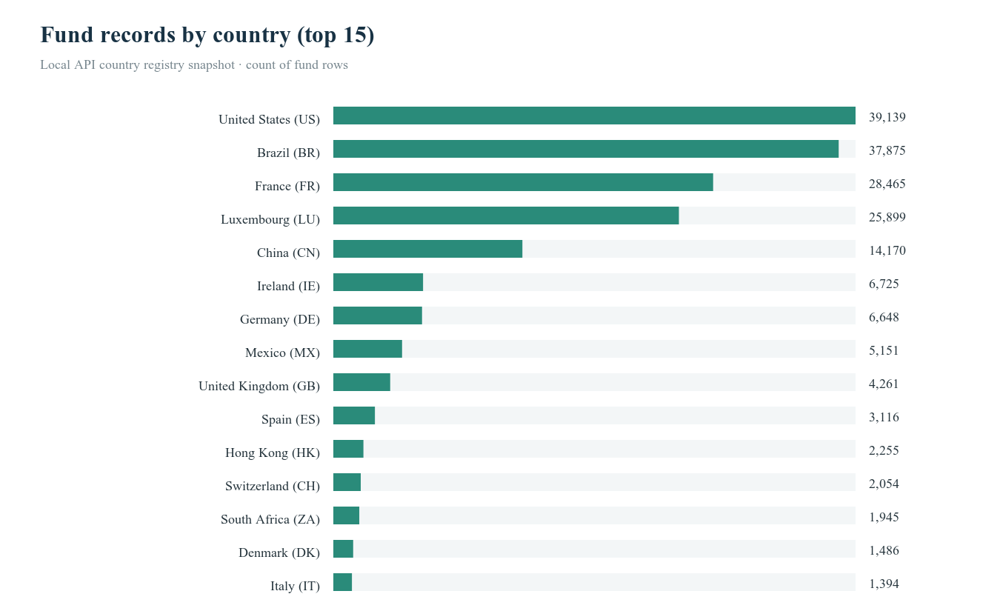
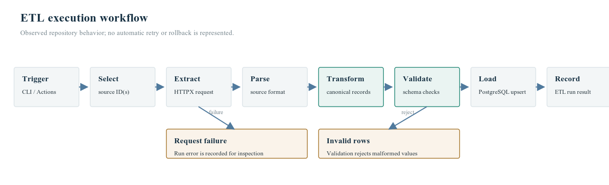
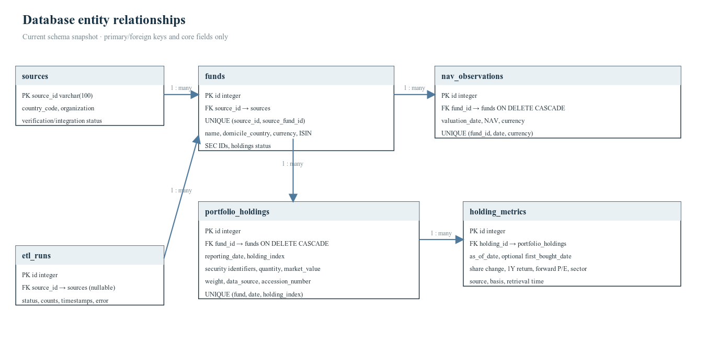
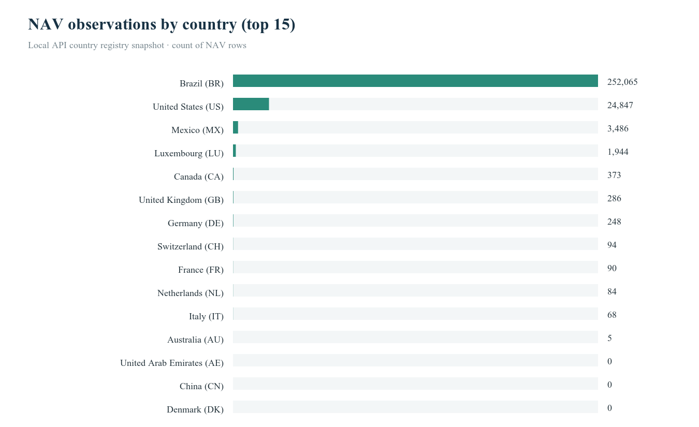
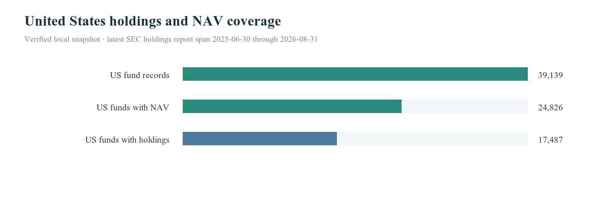
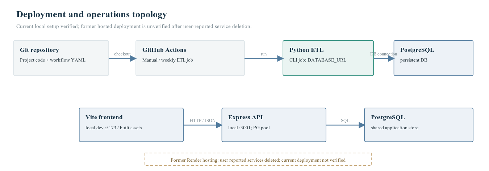
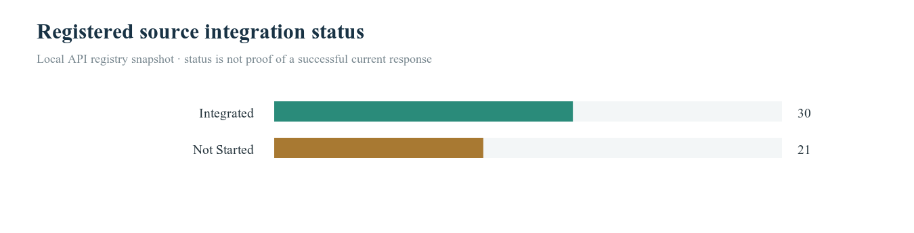

# FundFlow — Global Mutual Fund ETL Pipeline

**Complete Technical Documentation and Implementation Report**  
**Evidence snapshot:** 28 October 2026 · local project/API evidence

## Table of Contents

1. [Executive Summary](#s1) 2
2. [Project Overview](#s2) 3
3. [Country Coverage](#s3) 4
4. [Data Sources and Verification](#s4) 7
5. [ETL Architecture and Execution](#s5) 8
6. [Data Model and Database](#s6) 9
7. [Dashboard and Fund Profiles](#s7) 11
8. [NAV Coverage](#s8) 12
9. [Portfolio Holdings](#s9) 13
10. [US Mutual Fund Holdings](#s10) 14
11. [REST API](#s11) 15
12. [Technology and Configuration](#s12) 16
13. [Deployment and Automation](#s13) 17
14. [Verified Statistics](#s14) 18
15. [Charts and Diagrams](#s15) 20
16. [Quality, Security, and Limitations](#s16) 21
17. [Test and Verification Results](#s17) 22
18. [References and Evidence](#s18) 23

## 1. Executive Summary {#s1}

FundFlow is a multi-country mutual-fund catalogue and NAV ETL application. The inspected project combines Python connectors and ETL, PostgreSQL persistence, a Node.js/Express API, and a React/Vite dashboard. Its local API snapshot reports **183,169 fund records**, **283,590 NAV observations**, **24 configured markets**, **51 registered sources**, and **30 sources marked Integrated**.

The separate SEC holdings snapshot previously verified in the same local database reports **17,487 US funds with holdings and 5,433,511 filed position rows**. Coverage is not global: no Brazil holdings rows were present in that snapshot, despite Brazil having 37,875 fund records and 252,065 NAV observations. Optional market metrics belong to `holding_metrics`, distinct from filed portfolio positions. Production hosting was not verified; the owner reported deleting the prior Render services. These figures describe a dated local snapshot, not a live deployed service.

**Evidence status.** “Verified” below means confirmed from repository code, the local API snapshot, or the prior read-only database query as identified in the Evidence Notes. Source registry metadata can be candidate or unverified: being listed or marked integrated does not prove each URL is reachable or that every field is licensed for reuse. The database could not be freshly queried during this report generation because its local PostgreSQL connection was unavailable; the holdings counts therefore retain their prior snapshot provenance.

## 2. Project Overview {#s2}

FundFlow consolidates fund master records and net asset values from public and official datasets into a common database, exposes that information through a REST API, and presents it in a dashboard. The user-facing functions observed in source include overview statistics, country/source views, fund search/filtering, fund details, NAV history, portfolio holdings, and ETL run history/control.

The architecture is appropriate for a data-oriented portfolio project: source-specific adapters isolate upstream formats, database uniqueness constraints support repeatable ingestion, and the API keeps frontend requests away from direct SQL access. No user portfolio or trading workflow is documented as implemented.

## 3. Country Coverage {#s3}

The country API returns **25 registry codes**; the dashboard statistic reports **24 configured countries** because Spain (`ES`) is excluded from assignment-country count by the API query. The country table below follows the country endpoint, while “configured” follows `/api/v1/stats`. Counts are records stored under a country code, not estimates of each market's total mutual-fund universe.

**Figure 1.** Countries sorted by stored fund records. Values are generated from the country API snapshot; the chart shows the 15 largest markets.

| Code | Country | Region | Sources | Ingested sources | Funds | NAV observations | Registry status |
|---|---|---|---:|---:|---:|---:|---|
| AE | United Arab Emirates | Other markets | 1 | 0 | 0 | 0 | not_integrated |
| AU | Australia | Asia-Pacific | 3 | 2 | 97 | 5 | integrated |
| BR | Brazil | Other markets | 1 | 1 | 37,875 | 252,065 | integrated |
| CA | Canada | North America | 2 | 1 | 373 | 373 | integrated |
| CH | Switzerland | Europe | 3 | 2 | 2,054 | 94 | integrated |
| CN | China | Asia-Pacific | 1 | 1 | 14,170 | 0 | integrated |
| DE | Germany | Europe | 3 | 2 | 6,648 | 248 | integrated |
| DK | Denmark | Europe | 2 | 1 | 1,486 | 0 | integrated |
| ES | Spain | Europe | 1 | 1 | 3,116 | 0 | integrated |
| FR | France | Europe | 2 | 2 | 28,465 | 90 | integrated |
| GB | United Kingdom | Europe | 4 | 3 | 4,261 | 286 | integrated |
| HK | Hong Kong | Asia-Pacific | 2 | 1 | 2,255 | 0 | integrated |
| IE | Ireland | Europe | 2 | 1 | 6,725 | 0 | integrated |
| IT | Italy | Europe | 3 | 2 | 1,394 | 68 | integrated |
| JP | Japan | Asia-Pacific | 1 | 0 | 0 | 0 | not_integrated |
| KR | South Korea | Asia-Pacific | 1 | 0 | 0 | 0 | not_integrated |
| LU | Luxembourg | Europe | 4 | 3 | 25,899 | 1,944 | integrated |
| MX | Mexico | North America | 2 | 1 | 5,151 | 3,486 | integrated |
| NL | Netherlands | Europe | 3 | 2 | 1,390 | 84 | integrated |
| RU | Russia | Other markets | 1 | 0 | 0 | 0 | not_integrated |
| SE | Sweden | Europe | 2 | 1 | 726 | 0 | integrated |
| SG | Singapore | Asia-Pacific | 1 | 0 | 0 | 0 | not_integrated |
| TW | Taiwan | Asia-Pacific | 1 | 0 | 0 | 0 | not_integrated |
| US | United States | North America | 3 | 2 | 39,139 | 24,847 | integrated |
| ZA | South Africa | Other markets | 2 | 1 | 1,945 | 0 | integrated |

The accompanying `FundFlow_Country_Coverage_New.csv` also includes holdings counts. Holdings are currently evidenced only for the US in the prior snapshot; zero elsewhere means no holding rows observed in that snapshot, not proof the source has no holdings data. The United States totals are 39,139 funds, 24,847 NAV observations in the country API (the prior DB-specific US query counted 24,847 rows and 24,826 funds with NAV), and the SEC holdings totals stated above.

## 4. Data Sources and Verification {#s4}

The source catalogue has **51 source records** across public regulators, government agencies, exchanges, and data portals. Examples include the US SEC EDGAR Form N-PORT dataset and Brazil's CVM fund information / CDA holdings data. The inventory CSV retains each catalogue record's organization, URLs, access method, format, licensing fields, verification status, and integration status.

| Registry measure | Count | Interpretation |
|---|---:|---|
| Registered sources | 51 | Catalogue rows, not necessarily active integrations |
| Marked Integrated | 30 | Registry state only; connector success is separately logged |
| Not Started | 21 | No implemented integration status recorded |
| Usable fund data confirmed | 30 | Registry verification classification |
| Unavailable | 20 | Current registry verification classification |
| Accessible, no fund data | 1 | Accessible source with no usable fund records confirmed |

Licensing metadata is not fully resolved: 48 entries show `Unknown`, 2 `Permitted`, and 1 `Permission Required` in the snapshot. Commercial reuse must be checked against the source terms before external redistribution. Source-specific references are linked in `FundFlow_Data_Source_Inventory_New.csv`; the report references authoritative entry points in Section 18.

## 5. ETL Architecture and Execution {#s5}

Python CLI commands select source connectors, retrieve source payloads, parse records, map them to canonical schemas, validate field types, and persist accepted rows. The loader uses PostgreSQL conflict handling and the schema declares unique keys for source-native funds and fund/date/currency NAV observations. This supports repeatable upserts; it does not make every upstream feed complete or guarantee a full historical backfill.

**Figure 2.** Current workflow based on repository code. Validation and request failures are recorded/rejected as applicable; automatic retry/rollback is not depicted because it was not verified.

GitHub Actions defines a manual dispatch and weekly schedule (`0 2 * * 0` UTC). The workflow applies migrations, syncs the source catalogue, runs available connectors, syncs SEC holdings, and performs count checks. Workflow configuration does not prove that a run completed successfully. The most recent API/ETL run in the saved snapshot is `python-277`, succeeded, finished `2026-10-27T21:30:22.561Z`.

## 6. Data Model and Database {#s6}

The PostgreSQL schema separates catalogue entities, point-in-time observations, filed portfolio positions, optional position metrics, and run logs. The current Alembic head recorded in the prior inspection is `0006_portfolio_holding_details`.

**Figure 3.** Core tables, selected columns, key constraints, and relationship cardinalities. Full columns are documented in `FundFlow_Database_Inventory_New.md`.

| Table | Purpose | Key integrity rules |
|---|---|---|
| `sources` | Registry of source feeds | `source_id` primary key |
| `funds` | Fund metadata | `(source_id, source_fund_id)` unique; source FK |
| `nav_observations` | Daily/periodic NAV points | `(fund_id, valuation_date, currency)` unique |
| `portfolio_holdings` | Filed portfolio positions by report date | `(fund_id, reporting_date, holding_index)` unique; fund FK with cascade |
| `holding_metrics` | Optional sourced/calculated metrics | `(holding_id, data_source, as_of_date)` unique; holding FK with cascade |
| `etl_runs` | Python connector run outcomes | optional source FK, row counts, timestamps and error |
| `api_etl_runs` | API-triggered run log | API UUID, source selection, status and result details |
| `api_source_checks` | Source connectivity checks | source-linked check history |
| `alembic_version` | Migration revision state | Alembic-managed revision marker |

## 7. Dashboard and Fund Profiles {#s7}

The React dashboard calls API endpoints rather than embedding fund totals. It presents summary counts, country coverage, recent runs, recent funds, source status, and navigation to fund explorer, API explorer, and ETL control. Fund detail code supports fund metadata, NAV history, reporting-date selection, holdings rows, and sourced optional metrics. The frontend includes a responsive layout and theme styling, but a dedicated screenshot file could not be saved with the available UI capture tool; see the screenshots folder README for the capture steps. No screenshot is fabricated or embedded.

## 8. NAV Coverage {#s8}

The local API snapshot reports **283,590 NAV observations** across **57,135 funds** from the prior database query. The recorded date span was **2011-12-06 through 2026-10-27**. Country NAV counts are listed in the table and CSV. Country data is uneven: Brazil contributes 252,065 rows, Luxembourg 1,944, Mexico 3,486, and the US 24,847. Several countries have fund records but no NAV rows, so a nonzero fund count must not be read as NAV coverage.

**Figure 4.** NAV observations by country, sorted descending, top 15; generated from the same endpoint snapshot as the coverage table.

## 9. Portfolio Holdings {#s9}

Filed holdings are stored per fund and reporting date, preserving historical portfolios. Fields include security name, ticker, ISIN/CUSIP, quantity, market value/currency, portfolio weight, filing accession, source URL, source identifier, and retrieval timestamp. Optional metrics such as first bought date, share change, one-year return, forward P/E, and sector are stored separately in `holding_metrics`, with a source and as-of date. The prior local snapshot contained 355 metric rows; share-change values were present, while first-bought date, one-year return, forward P/E, and sector were not populated in that check. Missing optional values remain null; the UI should not infer or invent them.

The holdings endpoint supports report-date filtering and bounded pagination. Holdings availability should be interpreted separately from fund and NAV availability. Data originates from official filings where available; market metrics require their own verified provider and provenance.

## 10. US Mutual Fund Holdings {#s10}

The US collection uses SEC EDGAR Form N-PORT data (`sec_edgar_nport`). The prior local database query verified **17,487 US funds**, **5,433,511 position rows**, across **19 reporting dates** from **2025-06-30 to 2026-08-31**. US fund records total 39,139, leaving **21,652** without holdings rows in that snapshot. That gap may reflect filing/reporting eligibility, mapping coverage, fund type, or update timing; it is not evidence that those funds have no portfolio.

A coalesced key count of 264,440 was previously computed using CUSIP, ISIN, ticker, then security name. This is only a proxy for distinct securities and is not a canonical issuer/security count. Prior row-level quality check found no null security name, quantity, market value, or portfolio weight in the holdings rows; optional metrics can still be null. SEC reports are periodic filings, not real-time portfolios.

**Figure 5.** US funds with NAV and holdings compared with US fund records. Distinct security key is intentionally omitted because the available identifier fallback is not a canonical instrument identity.

## 11. REST API {#s11}

The Express API performs parameterized PostgreSQL queries, validates request parameters, bounds pagination, and routes errors through middleware. Database health is a separate route from general process health. The endpoint inventory and representative response contracts are in `FundFlow_API_Inventory_New.md`.

Key endpoints include `GET /health`, `GET /api/v1/health/database`, `GET /api/v1/stats`, `GET /api/v1/countries`, `GET /api/v1/sources`, `GET /api/v1/funds`, `GET /api/v1/funds/:id`, `GET /api/v1/funds/:id/nav`, `GET /api/v1/funds/:id/holdings`, and ETL run history/start routes. Fund listing accepts filters including country, currency, text, category/type/status, holdings status, ISIN, NAV availability, sort, page, and limit. The holdings limit is bounded (up to 5,000); NAV history is bounded separately.

## 12. Technology and Configuration {#s12}

| Layer | Technology verified in repository |
|---|---|
| ETL | Python, HTTPX, Pydantic, SQLAlchemy, Alembic |
| API | Node.js, Express, PostgreSQL `pg`, Zod |
| Frontend | React 18, Vite, Lucide icons |
| Database | PostgreSQL; local compose configuration is present |
| Automation | GitHub Actions workflow, scheduled and manual |
| Runtime configuration | `DATABASE_URL`, `USER_AGENT`, `HTTP_TIMEOUT_SECONDS`, API/admin settings |

Secret values are not included. Local and hosted database targets must be configured independently; copying local credentials/data into a report is neither required nor safe.

## 13. Deployment and Automation {#s13}

The local development topology includes Vite on port 5173, API on port 3001, and PostgreSQL configured by environment. GitHub Actions is configured to run ETL against the database URL stored as a repository secret. Earlier Render hosting was used, but the user later reported deleting those services; current production endpoints, database, frontend/backend hosting, and deployment health could not be verified for this report.

**Figure 6.** Current local/CI configuration; dashed hosted box explicitly marks the prior Render deployment as unverified.

## 14. Verified Statistics {#s14}

| Measure | Value | Evidence and caveat |
|---|---:|---|
| Funds | 183,169 | Local API `/stats`, snapshot 2026-10-28 |
| NAV observations | 283,590 | Local API `/stats`, same snapshot |
| Configured countries | 24 | Stats query excludes Spain; country API has 25 codes |
| Registered sources | 51 | Source catalogue API |
| Integrated sources | 30 | Registry state, not proof of live reachability |
| Funds with NAV | 57,135 | Prior direct local database query |
| US funds | 39,139 | Country API snapshot |
| US funds with NAV | 24,826 | Prior direct local database query |
| US holdings funds / rows | 17,487 / 5,433,511 | Prior direct local database query |
| Database size | 2,630 MB (~2.57 GiB) | Prior read-only database query; not freshly rechecked |
| Python ETL run rows | 232 total; 222 succeeded, 10 failed | Prior database query; success is historical |
| API ETL runs | 5 succeeded | Prior database query |

**Figure 7.** Registry counts generated from the 51-source API snapshot. Do not interpret as source uptime or successful current data extraction.

## 15. Charts and Diagrams {#s15}

All charts in this report are generated as SVG from the saved API country/source JSON snapshots or previously queried database counts. SVG preserves vector quality in the PDF. The architecture and workflow diagrams are hand-laid SVG derived from the inspected code and workflow. The ER diagram uses actual schema table names and constraints. Source files and figure outputs are saved separately under `reports/diagrams/FundFlow_New/` and `reports/figures/FundFlow_New/`.

## 16. Quality, Security, and Limitations {#s16}

The schema and loader use unique constraints/upserts to avoid duplicate source-native fund/NAV/holding rows. Source metadata exposes verification and licensing limitations. Request validation, parameterized queries, pagination bounds, and error middleware are implemented. Secrets are excluded from artifacts.

Limitations: coverage varies by country and by data type; source registry presence is not proof of usable data; license/commercial rights are unresolved for most sources; NAV histories can be sparse; filings are periodic; holdings are US-heavy; Brazil holdings were unavailable in the observed database; optional financial metrics are sparse and provider-dependent. Production is unverified after reported hosting deletion. Fresh DB checks could not run during this report build, and screenshots could not be persisted using the available UI capture interface.

## 17. Test and Verification Results {#s17}

The frontend production build passed using `npm run build` from `frontend/`. The API test suite was attempted using `npm test` from `api/`: 2 tests passed and 15 tests could not start because the sandbox denied localhost binding (`listen EPERM: operation not permitted 127.0.0.1`); this is an environment limitation, not a passing test result. Local API health and DB connection could not be rechecked during report generation because the local API was not running and direct PostgreSQL connection failed. Existing API snapshot files and previously queried database results were retained with their provenance and caveats.

## 18. References and Evidence {#s18}

1. SEC EDGAR Form N-PORT data sets: [SEC data page](https://www.sec.gov/dera/data/form-n-port-data-sets).
2. SEC EDGAR developer resources and fair-access guidance: [SEC developer resources](https://www.sec.gov/about/developer-resources).
3. Brazil CVM open data portal / fund datasets: [CVM Dados Abertos](https://dados.cvm.gov.br/).
4. PostgreSQL documentation: [PostgreSQL current documentation](https://www.postgresql.org/docs/).
5. Alembic documentation: [Alembic migration guide](https://alembic.sqlalchemy.org/en/latest/).
6. React documentation: [React](https://react.dev/).
7. Vite documentation: [Vite](https://vite.dev/).
8. Express documentation: [Express](https://expressjs.com/).
9. GitHub Actions documentation: [GitHub Actions](https://docs.github.com/actions).

The complete 51-source registry URLs and statuses are in `FundFlow_Data_Source_Inventory_New.csv`; country rollups are in `FundFlow_Country_Coverage_New.csv`. `FundFlow_Report_Evidence_New.md` distinguishes endpoint snapshots, repository inspection, prior DB queries, and checks that remain unavailable. URLs in the inventory are source catalogue claims; live reachability and legal usage should be independently rechecked before operational or commercial use.
