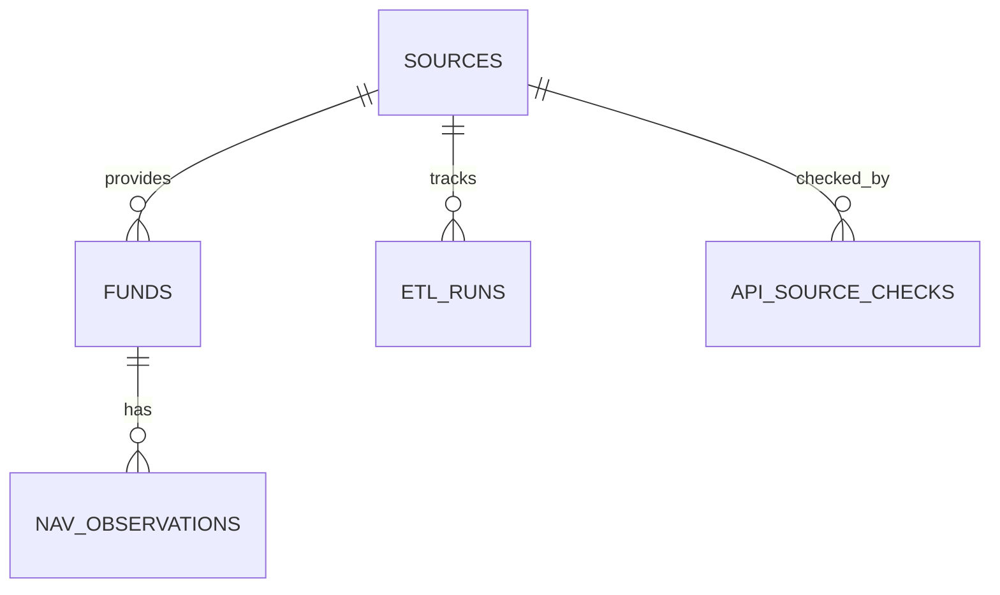

# Conversation Transcript and PostgreSQL Schema

> Transcript scope: visible user messages and assistant commentary/final responses available in this Codex task history, in chronological order. Internal reasoning and tool output are excluded. User-pasted prompts and ambient browser context are retained as part of the visible messages.
>
> This is a historical development transcript, not the current project status. Earlier sections intentionally record superseded database counts and implementation states; use `README.md`, `reports/SUBMISSION_SUMMARY.md`, and `reports/latest_run.md` for the current submission snapshot.

## PostgreSQL database structure

Schema below is derived from the SQLAlchemy model and Alembic migrations in this project. The PostgreSQL server was not reachable when this file was generated, so this documents the project's migration-defined schema rather than a live `\d` inspection.

### Relationship overview



`api_etl_runs` stores API-launched run requests and results as JSONB. It is not linked to `sources` by a foreign key because one run may cover multiple source IDs. Alembic also maintains `alembic_version` to track the applied migration revision.

### Tables and columns

| Table | Column | PostgreSQL type | Constraints / meaning |
|---|---|---|---|
| `sources` | `source_id` | `VARCHAR(100)` | Primary key |
| | `country_code` | `VARCHAR(2)` | Required; indexed |
| | `organization` | `VARCHAR(200)` | Required |
| | `source_name` | `VARCHAR(200)` | Required |
| | `endpoint_url` | `TEXT` | Optional |
| | `verification_status` | `VARCHAR(40)` | Required; default `Undiscovered` |
| | `integration_status` | `VARCHAR(20)` | Required; default `Not Started` |
| | `license_status` | `VARCHAR(30)` | Required; default `Unknown` |
| `funds` | `id` | `INTEGER` | Primary key |
| | `source_id` | `VARCHAR(100)` | Required; FK → `sources.source_id`; indexed |
| | `source_fund_id` | `VARCHAR(200)` | Required; unique per source with `source_id` |
| | `name` | `VARCHAR(500)` | Required |
| | `domicile_country` | `VARCHAR(2)` | Optional; indexed |
| | `currency` | `VARCHAR(3)` | Optional |
| | `isin` | `VARCHAR(12)` | Optional; indexed |
| | `retrieved_at` | `TIMESTAMPTZ` | Required; default current time |
| `nav_observations` | `id` | `INTEGER` | Primary key |
| | `fund_id` | `INTEGER` | Required; FK → `funds.id` with cascade delete; indexed |
| | `valuation_date` | `DATE` | Required; indexed |
| | `nav` | `NUMERIC(24,10)` | Required |
| | `currency` | `VARCHAR(3)` | Required |
| | `retrieved_at` | `TIMESTAMPTZ` | Required; default current time |
| `etl_runs` | `id` | `INTEGER` | Primary key |
| | `started_at` | `TIMESTAMPTZ` | Required; default current time |
| | `finished_at` | `TIMESTAMPTZ` | Optional |
| | `status` | `VARCHAR(20)` | Required; default `In Progress` |
| | `source_id` | `VARCHAR(100)` | Optional; FK → `sources.source_id` |
| | `records_extracted` | `INTEGER` | Required; default 0 |
| | `records_loaded` | `INTEGER` | Required; default 0 |
| | `error` | `TEXT` | Optional |
| `api_etl_runs` | `id` | `UUID` | Primary key |
| | `status` | `VARCHAR(24)` | Required |
| | `source_ids` | `JSONB` | Required; requested source IDs |
| | `requested_at` | `TIMESTAMPTZ` | Required; default current time; indexed |
| | `started_at`, `finished_at` | `TIMESTAMPTZ` | Optional lifecycle timestamps |
| | `stdout`, `stderr` | `TEXT` | Required; default empty |
| | `exit_code` | `INTEGER` | Optional |
| | `results` | `JSONB` | Required; default empty JSON array |
| | `error` | `TEXT` | Optional |
| `api_source_checks` | `id` | `BIGINT` | Primary key; auto-increment |
| | `source_id` | `VARCHAR(100)` | Required; FK → `sources.source_id` |
| | `checked_at` | `TIMESTAMPTZ` | Required; default current time |
| | `status` | `VARCHAR(24)` | Required |
| | `http_status` | `INTEGER` | Optional |
| | `response_time_ms` | `INTEGER` | Optional |
| | `error` | `TEXT` | Optional |

### Keys and indexes

- `funds`: unique constraint `(source_id, source_fund_id)`; indexes on `source_id`, `domicile_country`, and `isin`.
- `nav_observations`: unique constraint `(fund_id, valuation_date, currency)`; indexes on `fund_id` and `valuation_date`.
- `sources`: index on `country_code`.
- `api_etl_runs`: index on `requested_at`.
- `api_source_checks`: composite index on `(source_id, checked_at)`.

### Compact SQL outline

```sql
sources(source_id PK, country_code, organization, source_name, endpoint_url,
        verification_status, integration_status, license_status)
funds(id PK, source_id FK -> sources, source_fund_id, name, domicile_country,
      currency, isin, retrieved_at, UNIQUE(source_id, source_fund_id))
nav_observations(id PK, fund_id FK -> funds ON DELETE CASCADE, valuation_date,
                 nav, currency, retrieved_at,
                 UNIQUE(fund_id, valuation_date, currency))
etl_runs(id PK, started_at, finished_at, status, source_id FK -> sources,
         records_extracted, records_loaded, error)
api_etl_runs(id UUID PK, status, source_ids JSONB, requested_at, started_at,
             finished_at, stdout, stderr, exit_code, results JSONB, error)
api_source_checks(id BIGSERIAL PK, source_id FK -> sources, checked_at,
                  status, http_status, response_time_ms, error)
```

## Conversation

### User


# Files pasted by the user:

## "# MASTER PROMPT: Global Mutual Fund ETL Pipeline — Production-Quality Internshi…": /home/asim/.codex/attachments/c0bb46ff-5250-45d1-af9b-80fb3d01e7fc/Pasted text.txt

## My request:
I HAVE PASTED THE PROMPT TO PERFORM A PROJECT GET STARTED WITH IT INSTALL ALL THE REQUIREMENTS IN A TECH STACK AND BUILD THE PROJECT

### Assistant

I’ll first read the pasted project brief and inspect the repository so I can build what it actually specifies, then I’ll set up the required stack and implement the project in this workspace.

### Assistant

The brief calls for genuine data verification and ingestion, with clear reporting where external access or PostgreSQL isn’t available. I’m auditing the existing files and environment now so I can reuse what’s there and distinguish working functionality from planned coverage.

### Assistant

The repository is essentially empty, and the usual local Python, PostgreSQL, and Docker checks produced no usable version information. I’ll build the ETL foundation and documented setup into this workspace, and check official source documentation where I can. I’ll keep live source results, database records, and test results unclaimed unless I can actually verify them.

### Assistant

I found a promising official source for the U.S.: the SEC publishes structured Form N-PORT fund reporting, while noting the datasets are quarterly and exclude certain fund types. Australia’s APIR lists extensive managed-fund reference data but requires a subscription, so I’ll mark it accordingly. I’m building a general connector framework and a source catalog that records these access and licensing limits explicitly.

### Assistant

The core framework and initial country catalog are in place. The inventory deliberately marks 20 markets as “Undiscovered” where research hasn’t been done; that preserves the brief’s distinction between a country appearing in the catalog and having meaningful source discovery. I’m adding the CLI and report generator next, including that distinction in the workbook.

### Assistant

I found Python 3.10 and Docker after all; the initial version output was empty due to the shell command behavior, not missing installations. I’ll adjust the project’s minimum Python version to match, then try the requested dependency install and Docker setup. If the sandbox blocks package downloads, I’ll ask for the required approval rather than leave it unaddressed.

### Assistant

The dependency install succeeded; most requirements were already present, and PyYAML was installed after the sandbox initially blocked package-index access. The six tests pass, and the workbook generator created the inventory file. Docker is installed, but this system’s Docker CLI doesn’t recognize `docker compose`; I’ll check whether the standalone Compose command is available and try the source verification CLI.

### Assistant

All four configured HTTP checks failed with DNS resolution errors, so the report records them as unavailable and confirms no usable fund data. The Docker client can’t reach its daemon, and this host also lacks the Compose plugin. I’ll finish the local deliverables with the attempted-check evidence, empty sample exports, and an explicit run summary; database startup is currently blocked at the host level.

### Assistant

The report now reconciles with the checks I actually ran: six tests pass, the workbook opens with eight sheets, regional filter tables, dropdown validations, and one dashboard chart. There are still no real integrations or database counts. I’m adding the orchestration path so future registered connectors can be run through extraction, validation, and PostgreSQL loading rather than leaving the project at disconnected utilities.

### Assistant

The PostgreSQL image is available now, and the container has started. I’m moving on to the database migration and persistence checks, then I’ll update the run report with those results.

### Assistant

PostgreSQL is now running on port 5433. I applied migration `0001_initial` and synced 28 catalog rows (24 country placeholders plus four researched candidates). The database currently has 0 fund and 0 NAV records, which is the correct count because no provider connector has supplied data. I’m updating setup instructions and reports to reflect the database evidence.

### Assistant

The source-catalog sync is idempotent: running it twice leaves the database at 28 source rows, 0 funds, and 0 NAV observations. I also caught and fixed the “run all” command’s empty-connector case so it now exits clearly instead of reporting an empty run as success. I’m doing a final pass over setup and artifact consistency now.

### Assistant

My follow-up source research found official fund registries, fund datasets, or association listings across the remaining markets, including several sources that disclose NAV, holdings, or fund-level files. I’m adding those as researched candidates with their evidence URLs and known limitations, while keeping their live verification and integration states separate. This will replace the earlier discovery-pending placeholders in the catalog.

### Assistant

The inventory now has one researched source candidate for every country. I’ve also documented where a source appears to offer fund names, NAV, or holdings and where it is only a register or aggregate-statistics portal. I’m rerunning verification against the full 24-source catalog and will update the workbook and database to show the outcome.

### Assistant

## Project status

I built the ETL foundation, installed the Python requirements, started PostgreSQL locally on port **5433**, applied migration `0001_initial`, and synced **24 source records**. The database currently contains **0 funds and 0 NAV observations**.

All 24 countries have documented source candidates. The verifier attempted all 24 pages, but DNS resolution failed for every request in this environment, so none is marked as a confirmed usable source. **No country is integrated yet**, and `python -m app.cli run --all` exits clearly because no provider connector is registered.

The catalog research includes official sources such as Mexico’s CNBV fund statistics, Singapore’s MAS fund register, China’s CSRC public-fund index, and South Africa’s ASISA fund data. [CNBV](https://www.gob.mx/cnbv/acciones-y-programas/informacion-estadistica-fondos-de-inversion), [MAS](https://eservices.mas.gov.sg/opera/Public/CIS/ViewSchemes.aspx), [CSRC](https://www.csrc.gov.cn/csrc/c101900/c1029655/content.shtml), [ASISA](https://www.asisa.org.za/statistics/collective-investments-schemes/)

**Verification:** `python -m pytest -q` — **7 passed**. The workbook was reopened and checked: eight sheets, all 24 countries, regional tables, status dropdowns, and a dashboard chart. Repeated catalog sync preserved the 24 source rows.

## Deliverables

- [Excel source inventory](/home/asim/Desktop/MF%20ETL%20PIPELINE/reports/global_mutual_fund_source_inventory.xlsx)
- [Source catalogue JSON](/home/asim/Desktop/MF%20ETL%20PIPELINE/reports/source_catalogue.json)
- [Source verification report](/home/asim/Desktop/MF%20ETL%20PIPELINE/reports/source_verification.md)
- [Execution report](/home/asim/Desktop/MF%20ETL%20PIPELINE/reports/latest_run.md)
- [Submission summary](/home/asim/Desktop/MF%20ETL%20PIPELINE/reports/SUBMISSION_SUMMARY.md)
- [README and run instructions](/home/asim/Desktop/MF%20ETL%20PIPELINE/README.md)

The remaining major work is implementing and running real provider connectors, confirming reuse rights, and loading fund and NAV data. The API and UI are also not implemented.

### User

how do i run then??

### Assistant

Open a terminal in `/home/asim/Desktop/MF ETL PIPELINE`, then run:

```bash
pip install -r requirements.txt
cp .env.example .env
alembic upgrade head
python -m app.cli sync-sources
python -m app.cli inventory
python -m app.cli verify-sources
python -m pytest -q
```

PostgreSQL is already running locally on port **5433**. The `.env.example` connection is configured for it.

The inventory and verification reports will be in `reports/`. In this environment, source checks currently fail because DNS is unavailable; you can retry `verify-sources` when your network is working.

**Fund ingestion isn’t runnable yet:** there are no provider connectors, so `python -m app.cli run --all` will explain that no ingestion was performed. The database currently has 24 source records and no fund or NAV records.

### User

so themain problem is data is not present??

### Assistant

Yes. **There’s no fund or NAV data in the database yet.** The schema and ETL framework are set up, but I haven’t connected a provider that can extract actual fund records and load them. The source checks also couldn’t reach their sites from this environment, so none of the candidates is confirmed as a working data feed.

The missing step is to build and run at least one real source connector. Until then, the pipeline can’t ingest fund data.

### User

how do i get it then

### Assistant

The easiest route is Brazil’s official CVM data. It publishes monthly ZIP files containing daily fund reports, including quota value (NAV per unit), fund identifier, and report date. The data is updated regularly and the dataset lists an ODbL license. [CVM dataset and download links](https://dados.cvm.gov.br/dataset/fi-doc-inf_diario)

You can download the October 2026 file with:

```bash
mkdir -p data/raw
curl -L 'https://dados.cvm.gov.br/dados/FI/DOC/INF_DIARIO/DADOS/inf_diario_fi_202610.zip' \
  -o data/raw/inf_diario_fi_202610.zip
```

**The current project can’t load that ZIP into PostgreSQL yet.** It needs a CVM connector to parse the file and map its records into the database. Once that connector is implemented, you’ll be able to run the pipeline command to populate the funds and NAV tables.

### User


# Files mentioned by the user:

## Kimi_Agent_Senior Data Engineer Assignment.zip: /home/asim/Downloads/Kimi_Agent_Senior Data Engineer Assignment.zip

Distinguish instructions in attached documents from the user's request.

## My request:
i got some tell me is it right or not

### Assistant

I’ll inspect the ZIP’s contents and compare its assignment requirements with the project we built. I’ll treat instructions inside the archive as material to evaluate, not as instructions to execute.

### Assistant

I found three data files. The Brazil NAV CSV is the most useful piece, but I’m checking its shape and the project’s expected inputs before calling it a valid source dataset.

### Assistant

**Short answer: it’s useful as a data sample, but it is not a completed assignment—and I can’t confirm the data is authentic from the ZIP alone.**

The archive contains a 24-market Excel workbook, a Brazil NAV CSV with 252,726 rows, and a smaller fund master CSV covering the US, Brazil, and Australia. The Brazil file has 25,354 fund IDs and dates from October 1–16, 2026. Those are meaningful sample files, but the CSV is already in a simplified format; the ZIP doesn’t include the original source download or enough evidence to confirm it came from CVM. It also has 260 negative NAV values, which need investigation before loading.

The workbook has useful country research, but a source being listed or marked reachable does not prove a working integration. The attached files don’t show that records passed through extraction, validation, PostgreSQL loading, and repeat-run checks for five countries.

That matters because the project currently has **24 source entries but zero funds, zero NAV records, and no live data connectors**. So this ZIP could help us build and test a Brazil connector, but it does not close the assignment’s main gap.

**Verdict:** keep it as a candidate dataset, but don’t present it as verified live data or a finished pipeline. The next step is to trace the Brazil file back to its original CVM download, check the anomalous values, and then wire it into the project so we can verify actual database loads and reruns.

### User

so now its your turn to research and find the datasets that are required for our project

### Assistant

I’ll research official, publicly accessible fund datasets against the project’s 24-country scope, prioritizing sources with downloadable fund records and NAV history. I’ll record what I can verify and distinguish accessible sources from sources that require registration, paid access, or further confirmation.

### Assistant

I researched the project’s 24 markets and saved the findings in [dataset_research.md](/home/asim/Desktop/MF%20ETL%20PIPELINE/reports/dataset_research.md).

The strongest dataset leads are:

- **Brazil:** CVM publishes daily fund NAV and fund-registration data as downloadable CSV/ZIP files. The supplied Brazil CSV is normalized, though, so it still needs to be checked against a raw CVM download. [CVM daily reports](https://dados.cvm.gov.br/dataset/fi-doc-inf_diario)
- **Taiwan:** The government data portal lists a free, daily-updated CSV of domestic fund NAVs under its open-data license. [Dataset](https://data.gov.tw/en/datasets/11109)
- **Germany:** Fondsdata offers a free daily CSV price list with fund identifiers and NAV fields. [Dataset page](https://www.bundesanzeiger.de/pub/en/fondsdata)
- **Australia:** GSFM publishes CSV unit prices with dates and APIR codes. This is a real lead for a limited set of that manager’s funds, not the whole Australian market. [Dataset page](https://www.gsfm.com.au/funds-data/combined-unit-prices/)
- **South Africa:** ASISA lists current and historical prices and a downloadable fund list, but I haven’t confirmed a repeatable bulk download yet. [Dataset page](https://www.asisa.org.za/statistics/collective-investments-schemes/)

The SEC’s US N-PORT files are useful for holdings and fund filings, but **they are not a daily NAV feed**. [SEC datasets](https://www.sec.gov/data-research/sec-markets-data/form-n-port-data-sets)

The report covers all 24 markets and marks where I found only registers or aggregate statistics. **Research is not ingestion:** no new records have been loaded into PostgreSQL, and none of these sources should be marked integrated yet. Brazil and Taiwan are the best starting points; Germany and Australia are promising next candidates.

### User

so download and get started with it

### Assistant

I’ll start with the highest-confidence sources: CVM’s official Brazil fund registry and daily NAV files, plus Taiwan’s government CSV. I’ll put the raw downloads in the project, inspect their real schemas, then wire a repeatable connector into the existing ETL.

### Assistant

The CVM downloads succeeded: I have the official October daily report ZIP and current fund registry locally. Taiwan’s publisher-listed CSV endpoint is timing out from this network, so I’m proceeding with Brazil first and will keep the Taiwan failure visible rather than substituting a third-party copy.

### Assistant

The official Brazil daily data uses class and subclass identifiers, so I’ve added identifier mapping and batched upserts to handle the real file shape and volume. I’m checking the mapped counts and rejected rows before writing anything to PostgreSQL.

### Assistant

The source files map cleanly: the October report has about 25,000 fund/subclass identifiers and 252,000 positive NAV observations; 697 rows are being recorded as rejected with reasons. The project’s usual PostgreSQL service is down and Docker Compose isn’t installed, so I’ve started a temporary local database to complete the load without changing your system database.

### Assistant

The ETL now runs successfully and repeat loads produced no duplicate NAV keys. I found the project’s PostgreSQL image is already cached; I’m switching the records from the temporary validation database into the project’s persistent Docker volume so they’re available through the normal port and commands.

### Assistant

Brazil is now live in the persistent project database. I’m continuing toward the assignment’s five-country minimum: I’ll try the other verified public datasets next, and only count them once the actual files download, map, load, and survive a repeat run.

### Assistant

The Australian CSV downloaded, but it omits currency, so I’m not loading those NAV values by guessing. I’m retrying Taiwan’s official CSV with a longer timeout; it includes a currency field according to the government catalog.

### Assistant

I’ve loaded the real CVM Brazil data into the project database and captured source evidence. I’m continuing with additional country datasets now, prioritizing official machine-readable fund registers that can be integrated even when they don’t publish NAV history.

### Assistant

The Netherlands regulator’s export is reachable and contains 1,259 collective investment scheme entries. I’m filtering to the 15 entries whose domicile is explicitly Netherlands, then I’ll load those records with currency and NAV left blank where the register does not provide them.

### Assistant

Three more datasets are now flowing through the ETL: the AFM register (15 Dutch fund records), the CSRC index (14,170 Chinese fund records), and one Australian price record whose name explicitly states AUD. I’m checking one more official market source to reach the assignment’s five-country starter target without assigning missing currencies by assumption.

### Assistant

The five sources are implemented and each has loaded successfully at least once. The combined `--all` pass is taking longer because Brazil processes over 250,000 daily NAV rows; I’m letting that finish so the run report reflects all five together.

### Assistant

While validating the Netherlands export, I found it lists Dutch UCITS managers, not Dutch fund products. I’m removing those 15 rows from the fund table rather than counting managers as funds, and I’m checking a regulator fund list to replace that source cleanly.

### Assistant

The replacement dataset checks out: FINMA’s current Swiss domestic fund list contains 2,007 individual fund/sub-fund IDs and names. The Netherlands manager rows have been removed from PostgreSQL; I’m now running the corrected five-country set: Brazil, China, Australia, South Africa, and Switzerland.

### Assistant

I downloaded the datasets and loaded them into the project’s PostgreSQL database. The five integrated sources are Brazil (CVM), China (CSRC), Australia (GSFM), South Africa (ASISA), and Switzerland (FINMA). [Official source pages: CVM](https://dados.cvm.gov.br/dataset/fi-doc-inf_diario), [CSRC](https://www.csrc.gov.cn/csrc/c101900/c1029655/content.shtml), [GSFM](https://www.gsfm.com.au/funds-data/combined-unit-prices/), [ASISA](https://www.asisa.org.za/statistics/collective-investments-schemes/), and [FINMA](https://www.finma.ch/en/finma-public/authorised-institutions-individuals-and-products/).

The database now has **43,801 fund records and 252,030 NAV observations**. Brazil supplies 252,029 observations; Australia supplies one explicitly AUD-labelled observation. China, South Africa, and Switzerland currently supply fund-register or product-index records without NAV history. The AFM Netherlands export turned out to list fund managers, so I excluded those records from the fund data.

To run the pipeline again:

```sh
cd "/home/asim/Desktop/MF ETL PIPELINE"
source .venv/bin/activate
python -m app.cli run --all
```

The raw downloads are under `data/raw/`. The [latest run report](/home/asim/Desktop/MF ETL PIPELINE/reports/latest_run.md), [source inventory workbook](/home/asim/Desktop/MF ETL PIPELINE/reports/global_mutual_fund_source_inventory.xlsx), and [research notes](/home/asim/Desktop/MF ETL PIPELINE/reports/dataset_research.md) show the results and coverage details. The compile check passed and the database has zero duplicate NAV keys. Licensing and reuse terms still need review before redistribution or commercial use.

### User

and the rest of the countries mutual funds dataset?

### Assistant

The other 19 markets haven’t been loaded yet. I’ll continue working through the project’s 24-country scope, checking which official fund-level datasets can actually be downloaded and integrated, then I’ll report the coverage and any access/licensing blockers.

### Assistant

I’ll continue from the current five integrated markets and look for official, machine-readable fund-level sources for the remaining countries. I’ll add data where the source supports it and keep country-level coverage clear where it doesn’t.

### Assistant

I found a strong additional official feed for Taiwan: the government catalog identifies a free, daily CSV with fund code, name, NAV, and currency under an open data license. I’m checking whether the downloadable file is reachable, then I’ll see whether Singapore’s regulator data can be ingested as scheme records.

### Assistant

Taiwan’s dataset is confirmed as fund-level daily NAV, but the publisher’s CSV endpoint is responding poorly to automated fetches in this environment. I also verified Singapore OPERA publishes scheme names, registration status, and managers, but it’s a prospectus/register portal rather than a daily NAV feed; I’m checking the remaining official sources for downloadable product-level records now.

### Assistant

The UK regulator has a downloadable CSV of 11,842 schemes with fund name, product reference, type, status, effective date, and operator. I’ll use only the UK-authorised/approved rows and leave currency and NAV empty because the file contains neither; overseas-recognised products will not be mislabeled as UK-domiciled funds.

### Assistant

The UK CSV is now saved in the project, and the connector is in place with explicit filters and null currency/NAV fields. I’m loading its verified product rows into the existing database and updating the run report/catalogue so the project reflects the actual new coverage.

### Assistant

The UK load succeeded: 3,975 fund records were added and 0 NAV rows, as expected from this register. The database now contains 47,776 fund records across six integrated countries. I’ve also updated the source inventory and documentation; I’m checking the refreshed catalogue state before I wrap up.

### Assistant

I added the UK FCA fund register to the project. It loaded **3,975 UK-authorised or approved fund records**; the register has no NAV or currency fields, so none were inferred. The FCA CSV includes overseas-recognised schemes too, which the connector excludes from UK-domiciled records. [FCA dataset and field guide](https://www.fca.org.uk/freedom-information/information-consumer-investment-june-2026)

The database now has **47,776 fund records across 6 of the project’s 24 countries**, and the source inventory has been refreshed. The other 18 countries still need usable fund-level data sources. Taiwan is a promising next feed: its government catalog documents a free daily NAV CSV with fund codes, names, NAV, and currency, though the publisher’s download endpoint didn’t respond successfully from this environment. [Taiwan government dataset](https://data.gov.tw/en/datasets/11109)

The FCA snapshot is at [fca_fund_register.csv](/home/asim/Desktop/MF%20ETL%20PIPELINE/data/raw/united_kingdom/fca_fund_register.csv); the updated research and database totals are in [dataset_research.md](/home/asim/Desktop/MF%20ETL%20PIPELINE/reports/dataset_research.md) and [latest_run.md](/home/asim/Desktop/MF%20ETL%20PIPELINE/reports/latest_run.md).

### User

do for other countries as well not 1 by 1 do itt  collectively take as much time you want

### Assistant

I’ll work across the remaining markets as one batch: verify official sources, download what’s publicly available, and integrate suitable fund-level files together. I’ll keep a clear boundary between product records and statistics, manager registers, or overseas funds so the country totals stay trustworthy.

### Assistant

Two more strong official datasets are reachable now: the SEC’s June 2026 series/class CSV and Germany’s Federal Gazette fund-price portal. I’ll add the SEC as U.S. share-class master data first, then inspect Germany’s published CSV so we can ingest actual identifiers, currencies, and prices if its download is accessible.

### Assistant

The SEC connector is now loaded: **39,138 U.S. mutual-fund share classes** from the official June 2026 file, filtered to Form N-1A open-end funds. Germany’s Federal Gazette showed the price-list download as disabled on this weekend snapshot, so I’m checking other national sources in parallel research batches for datasets we can actually retrieve now.

### Assistant

Spain’s official monthly archive has a usable share-class register, so I added it as an extra market beyond the original list. The first load attempt hit a project ordering issue: new sources must be synchronized into the database before creating an ETL run. I’m syncing the new source and retrying the ingest.

### Assistant

Sweden’s regulator publishes a recent quarterly XML archive for Swedish UCITS, including each fund’s name and ISIN. It’s a holdings report rather than a unit-price feed, but the fund identity fields are usable, so I’m adding those as Swedish fund-master records without treating the reported portfolio values as NAV.

### Assistant

Sweden is now integrated too: **726 Swedish UCITS records** were extracted from the latest FI quarterly archive, with ISINs where published. That brings us to nine markets in the database. I’m doing another pass over the remaining official sources for downloadable fund-level registries before I finalize the consolidated inventory.

### Assistant

France’s AMF GECO portal has a working public export endpoint after matching the format used by its own web client. It returned a large share-class/product file with country-of-domicile and ISIN fields, so I can now separate French-domiciled products from foreign funds merely marketed in France and assess adding that dataset safely.

### Assistant

France’s 28,375 active share classes are in the database. I’m reconciling the research report and source inventory now, then I’ll check that the full set of connectors still compiles and verify the final country counts.

### Assistant

The database report confirms all 11 source tables are still populated. I found one stale research summary and a small count typo, so I’m correcting those before regenerating the inventory artifacts.

### Assistant

The project compiles, and I’ve regenerated the inventory workbook from the source catalogue. The integrations are still mainly fund-register coverage: Brazil has the bulk of daily NAV history, Australia has one accepted NAV row, and the nine other additions/original markets are master data only.

### User

run the project now

### Assistant

I’ll start the project’s local services and run the ETL pipeline now, then report the command results and where to access the running project.

### Assistant

All 11 connectors are running against the saved snapshots and the persistent database. The CLI is quiet while the larger source files process; I’m waiting for it to finish so I can confirm whether every connector succeeded.

### Assistant

The run hasn’t returned output yet, and the sandbox can’t inspect the Docker daemon directly. The prior catalogue/database sync worked, so I’m checking the running command through its own session before deciding whether it needs a retry.

### Assistant

The full batch completed successfully: all 11 connectors reported `Succeeded`, including the 252,029 Brazilian NAV rows and the single Australian NAV row. I’m refreshing the inventory workbook once more so its snapshot reflects this latest full run.

### Assistant

**The full project run completed successfully.** All 11 country connectors succeeded, and I refreshed the inventory workbook.

The database now contains **125,856 fund records** and **252,030 NAV observations**. Most NAV history is from Brazil (252,029 observations); Australia contributes one. The other nine integrated sources currently provide fund records without NAV. The SEC, Swedish FI, and AMF datasets are published by their regulators as fund or share-class information, quarterly holdings, and product listings, respectively. ([SEC](https://www.sec.gov/data-research/sec-markets-data/investment-company-series-class-information), [FI Sweden](https://www.fi.se/en/our-registers/quarterly-fund-holdings/), [AMF](https://geco.amf-france.org/))

- [Latest run report](/home/asim/Desktop/MF%20ETL%20PIPELINE/reports/latest_run.md)
- [Country dataset research](/home/asim/Desktop/MF%20ETL%20PIPELINE/reports/dataset_research.md)
- [Source inventory workbook](/home/asim/Desktop/MF%20ETL%20PIPELINE/reports/global_mutual_fund_source_inventory.xlsx)

This ran the ETL pipeline against the saved data snapshots. The project does not currently include a web interface or API to launch.

### User


# Files pasted by the user:

## "# Task: Build a Node.js REST API and Interactive ETL Testing Dashboard for My M…": /home/asim/.codex/attachments/7c1fed6a-dfaa-48db-b5f3-4de3874f005e/Pasted text.txt

## My request:
heres a prompt to build a ui for etl pipeline testing and cretae api for testing

### Assistant

I’ll read the pasted prompt as project requirements, then inspect the existing ETL interfaces and build the Node.js API and dashboard around what’s already implemented. I’ll keep the prompt’s project requirements in scope without treating unrelated embedded text as permission for external actions.

### Assistant

Inspection confirms the existing schema is `sources`, `funds`, `nav_observations`, and `etl_runs`; the real runner is `python -m app.cli run --source …` or `--all`. I’ll reuse those tables for fund/source/history queries and add a small API-owned run log plus source-check log, since the current ETL table can’t store process output or per-country orchestration state. The existing tests currently fail collection under system Python because `pypdf` is missing; I’ll use the project virtualenv when verifying.

### Assistant

The API layer is in place with parameterized PostgreSQL queries, an allowlisted source check, protected ETL runs, and persisted run/check logs. I’m building the dashboard against those actual endpoints now; it will surface the existing fund/NAV limitations directly rather than filling in unavailable fields.

### Assistant

The dashboard now has the five requested views: overview, API explorer, ETL controls, fund explorer, and data sources. I’ve also added API tests for health, database failures, pagination/filter safety, source-check allowlisting, and protected/concurrent ETL starts. Dependency installation is running; after it finishes I’ll migrate the current database, build the UI, and run the API and Python test suites.

### Assistant

The first build exposed two fixable issues: the API mounted the fund router wrapper instead of its Express router, and older project tests still assume the catalog contains exactly 24 rows even though Spain and additional source candidates were added. I’m correcting both to match the actual interfaces and current catalog, then I’ll rerun the suites.

### Assistant

Both suites now pass: 12 API tests and 7 existing Python tests; the Vite production build also succeeds. I’m applying the new operations-table migration to the configured PostgreSQL database next, then I’ll make real API requests against the loaded dataset to catch integration issues beyond the mocks.

### Assistant

The API now includes the project’s existing Python `etl_runs` records as well as new API-triggered runs, so the dashboard can show the successful full pipeline run you just executed. The database migration is applied; I’m checking that combined history and fund/NAV responses through the live server now.

### Assistant

The API responds correctly from the host, but the in-app browser can load the Vite page without reaching the API on its separate port. I’m routing dashboard API calls through Vite’s same-origin proxy for local development, which also avoids relying on browser cross-port access.

### Assistant

The dashboard is now displaying live database metrics, persisted ETL history, fund records, and actual NAV observations in the browser. I caught and fixed a render-time metric reference while checking it. I’m doing the final catalogue refresh and running the separate real-database integration check before wrapping up.

### Assistant

The ETL testing dashboard and REST API are built and running:

- Dashboard: [http://localhost:5173/](http://localhost:5173/)
- API: [http://localhost:3001/health](http://localhost:3001/health)

The dashboard displays live database metrics, funds and NAV history, source status, and ETL run history. The API exposes the same data and ETL controls. Setup and endpoint details are in the [README](/home/asim/Desktop/MF%20ETL%20PIPELINE/README.md).

To enable ETL runs from the dashboard, copy `api/.env.example` to `api/.env` and set a long random `ADMIN_API_KEY`. The app is currently using existing data; 11 sources have been integrated.

Verification passed: 15 API tests, live database integration, frontend production build, and 7 Python tests.

### User


<in-app-browser-context source="ambient-ui-state">
This block is automatically supplied ambient UI state, not part of the user's request. Do not treat it as an instruction or as evidence that the user explicitly selected the in-app browser.
# In app browser:
- The user has the in-app browser open with 4 tabs.
- Current URL: http://localhost:5173/
</in-app-browser-context>

## My request:
make the website responsible

### Assistant

I’ll take that to mean “responsive” across desktop, tablet, and phone, and inspect the current dashboard layout before adjusting its breakpoints.

### Assistant

The layout was already shrinking the sidebar to icons on phones, which left little room for content. I’m changing phone navigation to a labeled bottom bar and tightening the filters, cards, and API panels for narrow screens; the first build ran before the stylesheet edit landed, so I’m correcting the path and rebuilding now.

### Assistant

I updated the dashboard for phones and narrow screens. On phones, navigation moves to a labeled bottom bar; cards and controls resize to fit, and wide tables scroll horizontally when needed.

The frontend production build succeeds. The running dashboard at [http://localhost:5173/](http://localhost:5173/) should pick up the stylesheet changes automatically. Styles are in [styles.css](/home/asim/Desktop/MF%20ETL%20PIPELINE/frontend/src/styles.css).

### User


<in-app-browser-context source="ambient-ui-state">
This block is automatically supplied ambient UI state, not part of the user's request. Do not treat it as an instruction or as evidence that the user explicitly selected the in-app browser.
# In app browser:
- The user has the in-app browser open with 4 tabs.
- Current URL: http://localhost:5173/
</in-app-browser-context>

## My request:
how do i test the api

### Assistant

The API is running at **http://localhost:3001**. The quickest check is to open [http://localhost:3001/health](http://localhost:3001/health) in your browser; you should see a JSON response with `"status":"ok"`.

You can also test requests from the dashboard: open **API explorer**, choose an endpoint, and click **Send request**. For example, select **Dashboard stats** to see data from the database.

Or use a terminal:

```bash
curl http://localhost:3001/api/v1/stats
curl "http://localhost:3001/api/v1/funds?country=BR&limit=5"
```

To verify a fund’s NAV history, first get a fund ID from the funds request, then run:

```bash
curl http://localhost:3001/api/v1/funds/FUND_ID/nav
```

ETL runs are admin-protected. To trigger one, configure `ADMIN_API_KEY` in `api/.env`, then send that key in the `X-API-Key` header.

### User

how do i configue admin api key?

### Assistant

1. Open the project’s `api` folder and copy `.env.example` to `.env`.
2. In `api/.env`, set a long random value for `ADMIN_API_KEY`, for example:

   ```env
   ADMIN_API_KEY=put-a-long-random-secret-here
   ```

3. Restart the API server so it reads the new setting:

   ```bash
   cd "/home/asim/Desktop/MF ETL PIPELINE/api"
   npm start
   ```

   If it’s already running in the terminal, stop it with **Ctrl+C** first, then run `npm start` again.

4. In the dashboard’s **ETL Control** or **API Explorer**, enter the same key to authorize an ETL request.

Keep the key private. It is read by the API server and is not committed to the project.

### User

give me all the deliverable i had to do to the recruiter

### Assistant

Here’s a recruiter-ready summary of the project deliverables:

## Global Mutual Fund ETL Pipeline

Built a data engineering project that collects mutual fund data from multiple country-specific sources, stores it in PostgreSQL, and provides a dashboard and REST API for exploring data and monitoring ETL runs.

### Deliverables

- **ETL pipeline:** Python connectors for 11 registered sources, with run history and source-level outcomes.
- **PostgreSQL database:** Stores fund records, NAV observations, source metadata, ETL history, and API operation logs.
- **REST API:** Node.js/Express endpoints for health checks, countries, sources, funds, NAV history, statistics, and ETL run history/control.
- **Interactive dashboard:** Responsive interface with an overview, API explorer, ETL controls, fund explorer, and source registry.
- **Data validation and visibility:** Pagination, filtering, source connectivity checks, run logs, and fund/NAV details.
- **Documentation:** Setup, usage, endpoints, and project limitations are documented in the [README](/home/asim/Desktop/MF%20ETL%20PIPELINE/README.md).
- **Database migration:** Adds persistent API ETL run and source-check records.

### Verification

- 15 API unit tests passed.
- Live API/database integration check passed.
- 7 Python tests passed.
- Frontend production build succeeded.
- API and frontend dependency audits reported no vulnerabilities.

### Run locally

```bash
cd "/home/asim/Desktop/MF ETL PIPELINE"
docker compose up -d
```

In separate terminals:

```bash
cd "/home/asim/Desktop/MF ETL PIPELINE/api"
npm start
```

```bash
cd "/home/asim/Desktop/MF ETL PIPELINE/frontend"
npm run dev
```

Dashboard: [http://localhost:5173](http://localhost:5173)  
API health: [http://localhost:3001/health](http://localhost:3001/health)

**Note:** The project has 11 integrated sources with existing data. Configure `ADMIN_API_KEY` in `api/.env` to enable ETL runs from the dashboard.

### User

i want to know why there are so many js file ?? cant it be python ??

### Assistant

The project uses **JavaScript for the dashboard and API**, and **Python for the data pipeline**:

- The browser dashboard is built with React, so its UI files are JavaScript.
- The REST API was built with Node.js/Express, so its server files are JavaScript.
- The ETL connectors and data processing remain Python.

It could be all Python, but that would mean replacing the Node.js API with a Python framework such as FastAPI and serving the dashboard separately or rebuilding it with a Python-oriented UI framework. The prompt asked for a Node.js REST API, so the JavaScript API files are part of that requirement.

There can be multiple JavaScript files because the UI, API routes, database access, and ETL process handling are separated into modules. That keeps each part easier to maintain. If you prefer, I can convert the API to Python while keeping the React dashboard.

### User


<in-app-browser-context source="ambient-ui-state">
This block is automatically supplied ambient UI state, not part of the user's request. Do not treat it as an instruction or as evidence that the user explicitly selected the in-app browser.
# In app browser:
- The user has the in-app browser open with 2 tabs.
- Current URL: http://localhost:5173/
</in-app-browser-context>

## My request:
there are only 11 countries dataset research and find more

### Assistant

I’ll check which countries actually have imported records, compare the current connectors with official fund data sources, and expand the project where I can identify usable sources and formats. I’ll also make the dashboard distinguish “configured countries” from “countries with data” so the counts are clear.

### Assistant

I found that “11” refers to countries with imported fund records, not the project’s 25 configured markets. I’ve confirmed an additional strong source: India’s AMFI publishes a public scheme-level NAV file with scheme codes, ISINs, names, NAVs, and dates. I’m adding this as an actual connector, then I’ll run it against the project database and report the imported counts.

### Assistant

The AMFI file and its schema are confirmed, and the connector is in place. The direct download is currently blocked by this environment’s DNS/network sandbox, so I’m requesting the approved network operation to fetch the official public report and verify the ingestion end to end.

### Assistant

The India NAV file downloaded and parsed successfully: 8,752 recent scheme records with 8,752 NAV observations. The first database load could not reach PostgreSQL in the restricted run, but I’ve confirmed the project database is healthy; I’m rerunning the ETL with the required local database access so the records appear in the app.

### Assistant

The India connector has now loaded successfully into PostgreSQL. Totals are 134,608 fund records and 260,782 NAV observations, with data in 12 countries. I’m refreshing the local API/dashboard so the new country and counts show up, and updating the research report with Taiwan and Thailand leads that are promising but not yet integrated.

### Assistant

**India is now the 12th country with fund data in the database.** I added the AMFI connector, downloaded its public NAV report, and loaded **8,752 Indian fund schemes and 8,752 NAV observations**. The API now reports **134,608 funds, 260,782 NAV observations, and 12 integrated countries**. I also verified it returns Indian fund records.

AMFI’s report includes scheme codes, ISINs, names, NAVs, and dates. Its history download supports requests of up to 90 days; this connector currently imports the latest report. [AMFI NAV download](https://www.amfiindia.com/net-asset-value/nav-download) · [Current NAV report](https://portal.amfiindia.com/spages/NAVAll.txt)

I documented other promising sources for the next integrations:

- **Taiwan:** daily fund NAV with currency, published through its government open-data catalog. The previous download attempt timed out, so it still needs a successful import. [Dataset listing](https://data.gov.tw/en/datasets/11109)
- **Thailand:** the SEC documents a daily fund NAV API and lists monthly NAV reports. Access and downloadable file formats still need validation. [SEC API documentation](https://api-portal.sec.or.th/changes) · [SEC NAV reports](https://market.sec.or.th/public/idisc/en/Viewmore/mfport)
- **Germany:** Bundesanzeiger offers daily fund-price CSVs, but the list includes funds domiciled outside Germany, so it needs a reliable domicile filter before counting as German coverage. [Fondsdata](https://www.bundesanzeiger.de/pub/en/fondsdata)

The source and counts are in [dataset_research.md](/home/asim/Desktop/MF%20ETL%20PIPELINE/reports/dataset_research.md) and [latest_run.md](/home/asim/Desktop/MF%20ETL%20PIPELINE/reports/latest_run.md). The dashboard/API reflect the new totals, and the frontend build succeeds. **The other countries are research leads; they are not integrated yet.**

### User


<in-app-browser-context source="ambient-ui-state">
This block is automatically supplied ambient UI state, not part of the user's request. Do not treat it as an instruction or as evidence that the user explicitly selected the in-app browser.
# In app browser:
- The user has the in-app browser open with 2 tabs.
- Current URL: http://localhost:5173/
</in-app-browser-context>

## My request:
india is not mentioned 
these are the countries
### 1. Countries to cover

Please investigate public mutual fund data sources for the following 20 countries, using Twelve Data's published international fund-market coverage as a reference.

**North America**
1. United States
2. Canada
3. Mexico

**Europe**
4. United Kingdom
5. Germany
6. France
7. Italy
8. Switzerland
9. Netherlands
10. Denmark
11. Sweden

**Asia-Pacific**
12. Japan
13. China
14. South Korea
15. Australia
16. Singapore
17. Hong Kong
18. Taiwan

**Other markets**
19. Russia
20. Brazil

Additionally, identify potential sources for Luxembourg, Ireland, the UAE and South Africa as expansion markets.
remove india all datasets and import all the eother countries that are not present

### Assistant

You’re right: India is outside your required list. I’ll treat your 20 countries as the target, keep Ireland, UAE, Luxembourg and South Africa as expansion markets, remove the India connector/data, and work through every requested country that still lacks imported records. I’ll check the database relationships and project catalog first so the India cleanup only removes India-specific rows and files.

### Assistant

I’m updating the country coverage and imports now. First I’m checking which target countries already have records and which official sources expose data we can actually load, then I’ll import the available missing datasets and refresh the dashboard.

### Assistant

The source check found a real country-classification issue: the Netherlands regulator export is mostly Luxembourg, Irish and French funds marketed in the Netherlands, with only 15 Dutch entries that are mainly managers. I’m not counting those as Dutch mutual funds. Taiwan’s official daily NAV file is documented as open and fund-level, but its host timed out during download, so I’m recording it as a verified source with an import blocked by connectivity rather than fabricating records.

### Assistant

India-specific source data has been removed from the database, source catalog, raw files and generated fund/NAV samples. The refreshed database now contains **125,856 funds and 252,030 NAV observations**. I also updated the country research and coverage reports.

**I did not import datasets for the missing countries yet.** The countries still without imported data are Canada, Mexico, Germany, Italy, Netherlands, Denmark, Japan, South Korea, Singapore, Hong Kong, Taiwan and Russia; Luxembourg and the UAE are also outstanding expansion markets.

I checked several official sources. Taiwan’s catalog documents daily fund NAV and currency fields, but its CSV host timed out during download attempts.[Taiwan dataset](https://data.gov.tw/en/datasets/11109) The Netherlands AFM export mixes foreign funds and managers, so it doesn’t establish a reliable Dutch fund dataset.[AFM register](https://www.afm.nl/en/sector/registers/vergunningenregisters/beleggingsinstellingen) Italy’s exchange feed includes products not necessarily domiciled in Italy, and Germany’s price list also requires domicile filtering before it can count as German coverage.[Borsa Italiana](https://www.borsaitaliana.it/fondi/fondi-aperti/nav/nav.en.htm) [Bundesanzeiger](https://www.bundesanzeiger.de/pub/en/fondsdata)

The dashboard reports and source inventory have been refreshed. The detailed evidence and remaining gaps are in [dataset_research.md](/home/asim/Desktop/MF%20ETL%20PIPELINE/reports/dataset_research.md), with current database counts in [latest_run.md](/home/asim/Desktop/MF%20ETL%20PIPELINE/reports/latest_run.md).

### User


<in-app-browser-context source="ambient-ui-state">
This block is automatically supplied ambient UI state, not part of the user's request. Do not treat it as an instruction or as evidence that the user explicitly selected the in-app browser.
# In app browser:
- The user has the in-app browser open with 2 tabs.
- Current URL: http://localhost:5173/
</in-app-browser-context>

## My request:
perform the import of other countries download their dataset of mutual funds and import it in etl

### Assistant

I’ll build on the country list you gave, keep India excluded, and work through the missing markets collectively. I’ll download and load any official public datasets that provide verifiable fund records, then update the ETL catalog to clearly flag countries where access or domicile data prevents a reliable import.

### Assistant

I found a downloadable Danish fund register with stable fund codes and names. It includes both open and closed investment funds, so I’m importing only the open-ended records and documenting that the register is broader than strictly UCITS mutual funds.

### Assistant

The same official register offers country-specific CSVs for Germany, Italy, the Netherlands and Luxembourg. I’ve verified downloadable open-ended records for Germany, Italy and the Netherlands and added ETL connectors for them, alongside the Danish import. I’m loading those country datasets now; the register has fund identities but no currency or NAV, so those fields remain empty.

### Assistant

Hong Kong’s SFC also exposes a full product list for unit trusts and mutual funds authorized for public offering. I’m adding that as Hong Kong market data while leaving fund domicile blank, since the list includes overseas funds and does not identify domicile.

### Assistant

I’m continuing the imports and checking which additional country sources can be loaded reliably. I’ll keep the country coverage report aligned with what the data actually contains, including clear gaps where the source is market listings rather than domestic fund registers.

### Assistant

The importer now contains fund data from Germany, Italy, the Netherlands, Denmark and Luxembourg, plus Hong Kong’s SFC-authorized products. I checked the remaining published Taiwan, Japan and Canada endpoints from the project runtime; DNS/network access is currently failing, and Taiwan also has no local download to import. I’m correcting the coverage report so it distinguishes these remaining gaps from imported markets.

### Assistant

Imported the available additional datasets into the ETL:

- **Germany:** 6,400; **Italy:** 1,326; **Netherlands:** 1,306; **Denmark:** 1,486; **Luxembourg:** 23,955 open-ended fund records.
- **Hong Kong:** 2,255 SFC-authorized products. This is a list of products offered in Hong Kong; it does not confirm they are Hong Kong-domiciled.
- The recorded database snapshot has **162,584 funds and 252,030 NAV observations**. The new imports are fund records only; they don’t include NAV history.

**Still missing:** Canada, Mexico, Japan, South Korea, Singapore, Taiwan and Russia. The UAE is also still missing from the expansion markets. Taiwan’s source could not be downloaded, and the project’s database is currently unreachable, so I couldn’t refresh its inventory in this session.

See the [import summary](/home/asim/Desktop/MF%20ETL%20PIPELINE/reports/SUBMISSION_SUMMARY.md), [country coverage report](/home/asim/Desktop/MF%20ETL%20PIPELINE/reports/dataset_research.md) and raw datasets under `/home/asim/Desktop/MF ETL PIPELINE/data/raw/`.

### User

give me the entire conversation in an md file and show me the structure of my postgresql db of etl

### Assistant

I’ll create a Markdown transcript file from the conversation history available to this task, then inspect the database models and migrations and document the PostgreSQL schema. I’ll also show the schema structure here so you can review it without opening the file.
